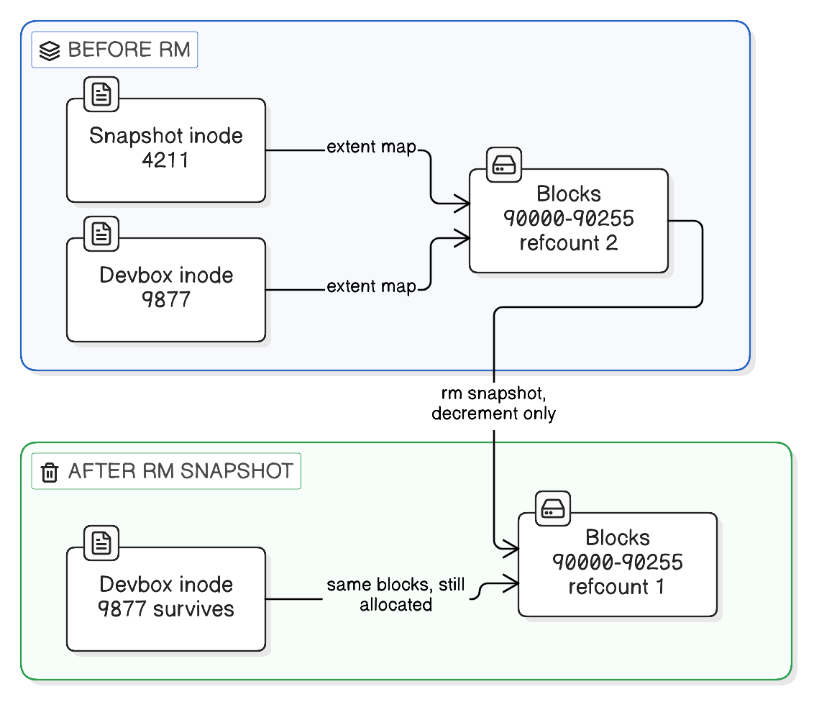

# Data Cloning for Dev/Test Environments (Reflink & Copy-on-Write)

> "Copying is cheap; copying *data* is expensive."
>
> *A reflink copy is the first without the second — a new file that points at the old file's blocks until somebody writes.*

## 1. The problem: every environment wants its own copy of production-shaped data

A team running many non-production environments — **devboxes** (one per engineer), **sandboxes** (short-lived, per-branch or per-feature), and **staging/UAT machines** (shared, pre-release) — hits the same wall: each of them needs a realistic database to be useful, and "realistic" means production-sized.

Giving each environment a full physical copy doesn't scale on either axis:

| | Full copy per environment | Consequence |
|---|---|---|
| **Time** | Restoring a few hundred GB of MySQL/Mongo data takes tens of minutes to hours | An engineer asking for "fresh data" loses half a day |
| **Space** | 20 devboxes × 300 GB = 6 TB | The volume fills up long before the team does |

**Data cloning** solves both by making the copy a *bookkeeping* operation instead of a *data* operation. One masked copy of production is prepared centrally; every environment then gets a near-instant, near-free clone of it via the file system's **reflink** support.

**Analogy.** A library keeps one master reference binder (**the shared snapshot on disk**). Instead of photocopying the whole binder for each reader, it hands each reader an index card saying "your binder *is* the master binder" (**the reflink — a new file whose extents point at the same blocks**). Reading costs nothing extra. The moment a reader scribbles on page 42, the library photocopies *only page 42* and staples it into that reader's card (**copy-on-write of just the modified blocks**); every other page is still the master's (**the untouched shared extents**). Nobody else sees the scribble, and the master is never altered.

### When does this technique apply?

- **Devboxes** — an engineer wants a database that looks like production, on demand, several times a week ("reset my box"). The clone is seconds, so resetting is cheap enough to be routine rather than a ticket.
- **Sandboxes / ephemeral environments** — a per-PR or per-branch environment that lives for hours. A full restore would dominate its entire lifetime; a clone makes the environment's startup cost effectively the container boot time.
- **Staging / UAT** — a shared pre-release environment refreshed before a release cycle or a UAT round, so testers validate against current-shaped data.
- **Destructive testing** — running a migration, a bulk backfill, or a data-fix script against a clone, then throwing it away and re-cloning. Because writes only diverge, "throw it away" costs nothing.
- **Debugging a production data bug** — clone the snapshot, reproduce locally against the same rows, without touching production.

One masked snapshot is built once, centrally; every environment then clones it in seconds:


### How to decide how to seed a non-prod environment

| Question to ask about your setup | Reflink clone from a shared snapshot | Dump & restore per environment | One shared non-prod DB for everyone | Synthetic / fixture data |
|---|---|---|---|---|
| **How often is the data reset, and how long can a reset take?** | Often, and it must be minutes. *Real-life:* a devbox fleet where engineers re-clone several times a week. | Rarely — a quarterly refresh where an hours-long restore is tolerable. *Real-life:* a single UAT box refreshed once per release. | Never reset individually; it's just there. *Real-life:* a shared QA database a whole team points at. | Every test run rebuilds it in seconds. *Real-life:* CI spinning up a container and running Flyway + seed scripts. |
| **How many independent copies do you need at once?** | Many, and they must not see each other's writes. *Real-life:* 20 devboxes + 8 staging + 4 UAT off one snapshot. | A handful — the storage cost is linear, so it caps out fast. *Real-life:* two long-lived pre-prod environments. | Exactly one; isolation isn't required. *Real-life:* a read-mostly integration environment. | Unlimited — each is tiny. *Real-life:* parallel CI jobs with Testcontainers. |
| **Does the test need production-*shaped* data (volume, skew, weird legacy rows)?** | Yes — the whole point is real cardinality and real edge-case rows. *Real-life:* reproducing a slow query that only misbehaves at production row counts. | Yes, same reason — you just pay full price per copy. *Real-life:* a performance-test environment loaded once and left alone. | Yes, but shared, so one tester's write corrupts another's scenario. *Real-life:* a demo environment. | No — a handful of hand-built rows is clearer and deterministic. *Real-life:* unit/integration tests asserting exact outputs. |
| **What is the storage and file-system situation?** | Source and destination on **one** reflink-capable file system (XFS `reflink=1`, Btrfs, APFS, ReFS). *Real-life:* snapshot and live data dirs on the same XFS volume. | Anything — works on ext4, across hosts, across clouds. *Real-life:* restoring a `mysqldump` onto a laptop. | Anything — there's only one copy. *Real-life:* a managed RDS instance. | Anything. *Real-life:* an in-memory H2/SQLite in tests. |
| **Who is allowed to see the data?** | Masked/anonymised once, centrally, before the snapshot is published — every clone inherits the masking. *Real-life:* PII scrubbed in the snapshot-building job. | Masking must be re-applied per restore, which people forget. *Real-life:* an ad-hoc dump someone took "just to debug". | One masked copy, tightly access-controlled. *Real-life:* a locked-down analytics replica. | No real data at all — the safest option by construction. *Real-life:* an open-source project's demo dataset. |

Rule of thumb: **synthetic data for tests that assert behaviour; cloned production-shaped data for tests that assert the system survives reality.** Most teams need both, not one.

## 2. Reflink

A reflink copy creates a new file that shares the original file's disk blocks. No file data is read or written — only metadata.

Normal copy:
```
file1 ──► [A][B][C][D]
file2 ──► [A][B][C][D]      ← data duplicated
```

Reflink copy:
```
file1 ──┐
        ├──► [A][B][C][D]   ← one set of blocks, shared
file2 ──┘
```

- **Time**: seconds, regardless of size (metadata only).
- **Space**: near zero at copy time.
- **Command**: `cp --reflink=always` (fail if unsupported) or `cp --reflink=auto` (fall back to a full copy).

## 3. Copy-on-write (CoW)

When a shared block is written, the file system writes the new data to a fresh block and repoints only the file being written.

```
file1 ──► [A][B][C ][D]
file2 ──► [A][B][C'][D]     ← only C' is new; A, B, D remain shared
```

- The original file never changes.
- Disk usage grows only by the blocks that differ, so a devbox that runs a week of tests still costs a fraction of a full copy.
- XFS allocates CoW space in chunks (CoW extent size hint, default up to ~128 KB).

### Example: inserting a row into a `wallet` table

- InnoDB modifies one or a few 16 KB pages in `wallet.ibd` (= 4 × 4 KB XFS blocks each).
- Only those blocks are copied; the rest of `wallet.ibd` stays shared.
- The same write also touches `#innodb_redo/*`, doublewrite (`#ib_16384_*.dblwr`), `undo_00*`, and `binlog.*`; each gets new blocks the same way.

### Shared blocks, not shared files — the reference count

A clone never points at a *file*. It points at *blocks*, and blocks are freed by a counter rather than by a filename. That single fact is what makes the snapshot safe to delete.

**Three levels of indirection.** Reading a file goes through three hops, and a reflink copies only the middle one:

```
path   /snapshot/mysql/wallet.ibd
  │      directory entry: name → inode number
  ▼
inode  4211
  │      extent map: "logical blocks 0–255 live at physical blocks 90000–90255"
  ▼
physical blocks  [90000 ... 90255]
```

`cp --reflink` creates a **new inode** for `/dbdata/mysql/wallet.ibd` and copies the *extent map* into it — the list of physical addresses. It copies no data, and it records nowhere that the source was named `wallet.ibd` or lived under `/snapshot`:

```
inode 4211  (snapshot) ──┐
                         ├──► blocks 90000–90255
inode 9877  (devbox)   ──┘
```

The two inodes are now peers. Neither is "the original" as far as the file system is concerned — there is no parent/child link stored anywhere, just two independent inodes listing the same addresses.

**Where the count lives.** XFS keeps a dedicated on-disk B-tree per allocation group, the **refcount btree** (`refcountbt` — the structure that `reflink=1` at `mkfs` time enables). It maps a block range to the number of inodes currently listing it, and the kernel follows three rules:

| Event | Effect on the refcount btree |
|---|---|
| Reflink a range | Increment its count |
| Write to a range whose count > 1 | Allocate a fresh block, write there, repoint **only the writing inode**, decrement the old range (this *is* copy-on-write) |
| Delete an inode | Decrement every range it lists; a range returns to the free-space tree only at **0** |

**Worked example.** One snapshot file, cloned to two devboxes, then the snapshot is deleted:

| Step | Inodes listing blocks 90000–90255 | Refcount | Blocks on disk |
|---|---|---|---|
| Snapshot built | 4211 | 1 | allocated |
| `cp --reflink` → devbox A | 4211, 9877 | 2 | same blocks, nothing copied |
| `cp --reflink` → devbox B | 4211, 9877, 9902 | 3 | same blocks |
| Devbox A inserts a row (touches block 90007) | A now lists 90000–90006, **204811**, 90008–90255 | 90007 drops to 2, new block 204811 has 1 | one 4 KB block added |
| `rm` the snapshot file | 9877, 9902 | 2 | **unchanged — still allocated** |

The `rm` is pure metadata: unlink the directory entry, free inode 4211, walk its extent map decrementing counts. Nothing is read, copied or moved, and both devboxes' MySQL instances notice nothing.



**Replacing** the snapshot is the same story from the other side. If the refresh job writes a *new* file at that path, it gets freshly allocated blocks and the old inode is simply dropped (count `3 → 2`, as above). If it overwrites *in place*, the kernel sees a count above 1 and copy-on-writes — so the **snapshot** is the file that gets new blocks, and the devboxes keep the originals. Either way the clone is untouched, because it owns block addresses, not a relationship to a file.

**Analogy.** Blocks are pallets in a warehouse. Each pallet has a tally card on the rack recording how many order forms currently claim it (**the refcount btree entry**). The snapshot's order form and the devbox's order form both list pallet #7 (**both inodes' extent maps hold the same block address**). Shredding the snapshot's order form (**deleting the snapshot file**) doesn't move or destroy the pallet — the warehouse just ticks the tally from 2 down to 1, because a form still claims it (**the blocks stay allocated**). The pallet is cleared out only when the tally reaches 0 (**the blocks return to the free-space tree**). And the devbox's form says "pallet #7", not "whatever the snapshot's form says" (**a physical address, not a reference to the other file**), so nothing that happens to the other form can invalidate it.

**The contrast that makes it click:**

| Mechanism | What's shared | Delete the source? |
|---|---|---|
| Symlink | the *path* | Breaks — dangling link |
| Hard link | the *inode* | Fine, but it's literally the same file: a write through one is visible through the other |
| Reflink | the *blocks*, refcounted | Fine, **and** the files stay independent: a write through one is invisible to the other |

A reflink is the useful middle — hard-link-cheap to create, with the independence of a real copy.

**Two consequences worth knowing:**

- **Deleting the snapshot doesn't free the space.** With 20 devboxes cloned off it, `rm -rf` on the snapshot drops every count from 21 to 20 and `df` barely moves. People delete it expecting hundreds of GB back and get nothing.
- **Refcounting protects a name, not the data.** It guarantees a clone survives deletion of the snapshot; it does nothing about losing the volume they both sit on. Hence "a clone is not a backup" below.

You can observe the sharing directly — `FIEMAP` marks shared extents with `FIEMAP_EXTENT_SHARED`:

```bash
filefrag -v /dbdata/mysql/wallet.ibd    # extents flagged 'shared'
xfs_bmap -v /dbdata/mysql/wallet.ibd    # physical ranges — identical to the snapshot's
```

## 4. Who does what

| Layer | Role |
|---|---|
| `cp -a --reflink` | Requests the clone via `ioctl(FICLONE)` per file. |
| Linux kernel / XFS | Creates shared block references, keeps refcounts, performs CoW on write. |
| MySQL (or Mongo/Redis/ES) | Unaware. Reads and writes its data files as normal files. |

Requirements:
- The file system must support reflink (XFS needs `reflink=1` at `mkfs` time).
- Source and destination must be on the **same** file system — this is why the snapshot and the live data directory are deliberately placed on one volume.

## 5. File system support

### Linux

| File system | Reflink | Notes |
|---|---|---|
| XFS | Yes | Requires `reflink=1` (default in modern `mkfs.xfs`). |
| Btrfs | Yes | CoW by design; also subvolume snapshots. |
| bcachefs | Yes | |
| OCFS2 | Yes | |
| ZFS (OpenZFS) | Partial | Block cloning since 2.2; disabled by default in some releases after an early data-corruption bug. |
| ext4 | No | `--reflink=always` fails; `--reflink=auto` does a full copy. |
| NFS 4.2 | If server FS supports it | Server-side clone. |

### Other OS

| OS | File system | Reflink |
|---|---|---|
| macOS | APFS | Yes (`cp -c`, Finder duplicate) |
| macOS | HFS+ | No |
| Windows | ReFS | Yes (block cloning; Dev Drive, Hyper-V) |
| Windows | NTFS | No |

### Volume-level CoW (related)

LVM thin snapshots, ZFS snapshots, Btrfs subvolume snapshots and cloud disk snapshots (e.g. AWS EBS) apply the same block-sharing principle to a **whole volume** instead of individual files. Same trade-off, coarser unit: you clone a disk rather than a directory, which suits VM-based environments where reflink-per-file isn't available.

## 6. Common mistakes

- **Assuming the clone is a backup.** It shares blocks with the snapshot on the same volume; losing the volume loses both.
- **Cloning across file systems.** `cp --reflink=auto` will silently do a full copy — the job "works" but takes an hour and fills the disk.
- **Deleting live data before validating the source.** Validate first, swap after.
- **Trusting the job's exit status.** Check that the database actually starts and that a known table has rows.
- **Forgetting masking is a property of the snapshot, not the clone.** If the snapshot-building job stops masking, every environment downstream quietly gains real PII.
