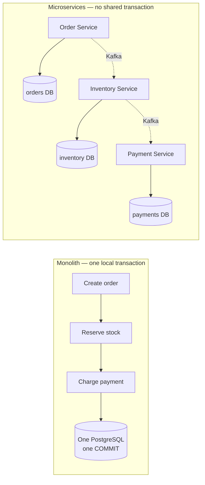
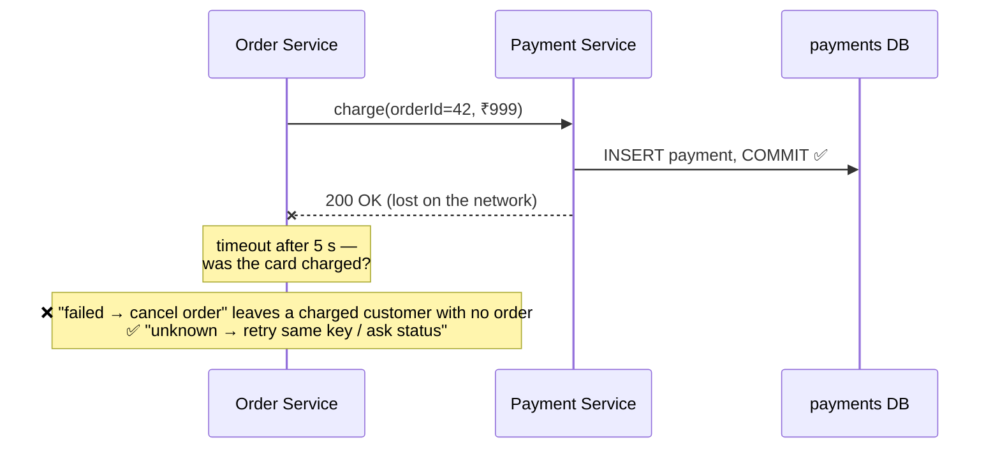
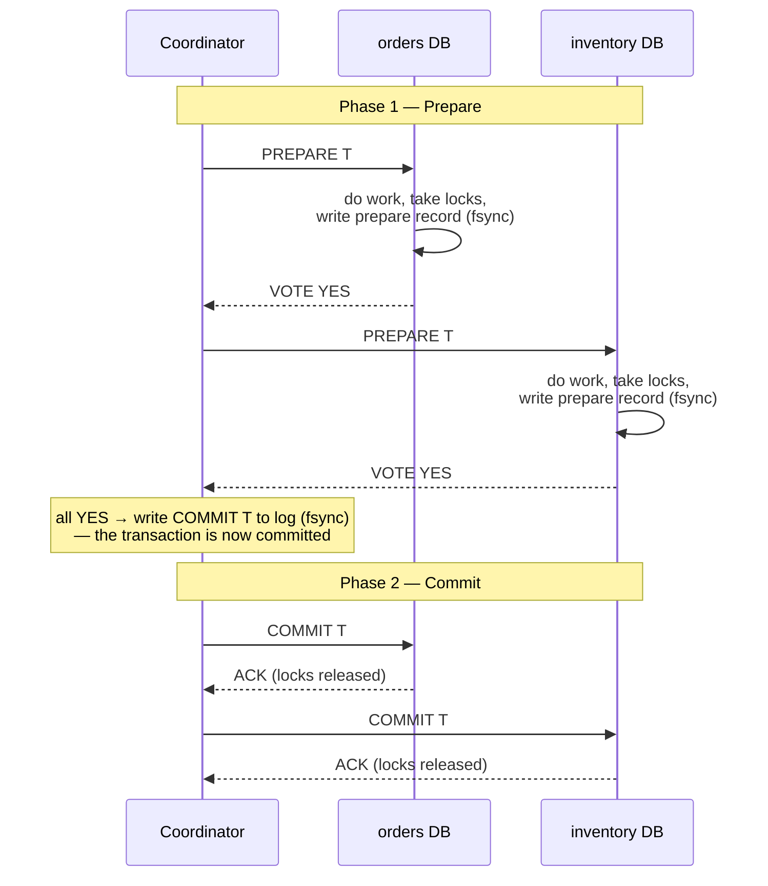
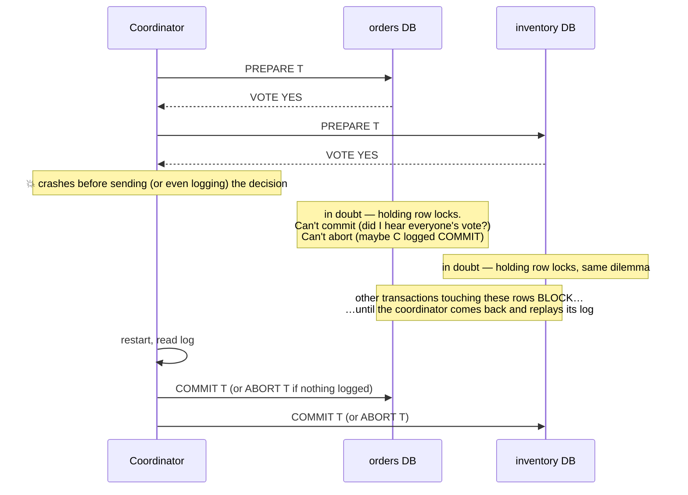
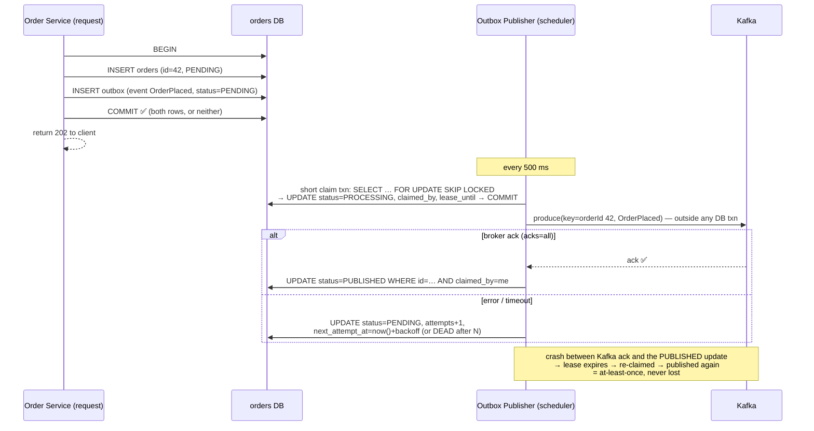
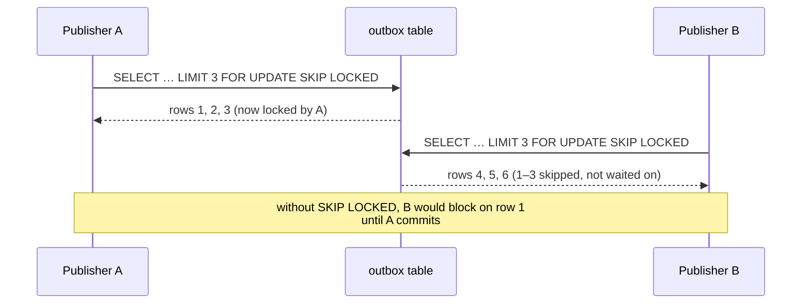
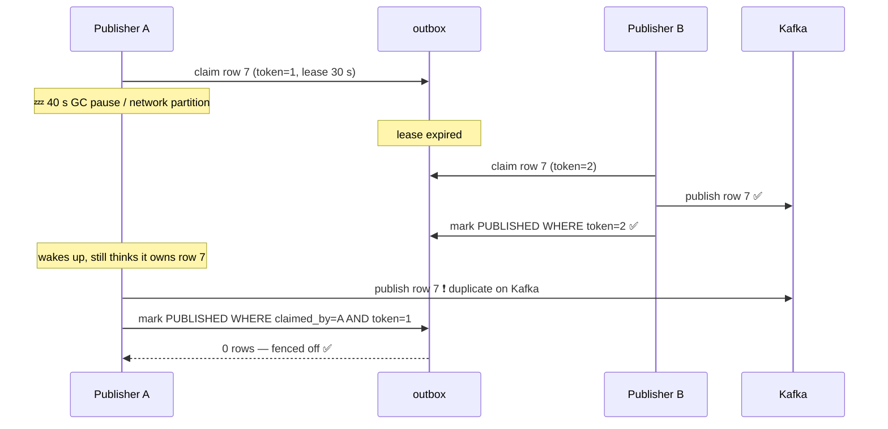

# Distributed Transactions: From ACID to Sagas, Outboxes and Leases

> "A distributed system is one in which the failure of a computer you didn't even know existed can render your own computer unusable."
> — Leslie Lamport (1987)
>
> *A distributed transaction is the attempt to make several such computers agree on one outcome — and most of this note is about what to do when they can't.*

This is the hub note for the whole topic. It covers the fundamentals, Two-Phase Commit and database-backed concurrency control in full, and summarises the patterns that have their own deep-dive notes:

| Chapter | Covered here | Deep dive |
|---|---|---|
| 1. Understanding distributed transactions | In full | — |
| 2. Two-Phase Commit (2PC) | In full | — |
| 3. Saga pattern | Essentials | [saga-pattern-compensating-transactions](saga-pattern-compensating-transactions.md) |
| 4. Idempotency | Essentials | [idempotency](idempotency.md) |
| 5. Transactional Inbox | Essentials | [outbox-and-inbox-patterns](outbox-and-inbox-patterns.md) |
| 6. Transactional Outbox | Essentials + full lifecycle diagram | [outbox-and-inbox-patterns](outbox-and-inbox-patterns.md) |
| 7. Concurrency control, claiming and leases | In full | — |
| 8. How to decide | Decision checklists | — |

The running example throughout: an e-commerce checkout with **Order Service**, **Payment Service**, **Inventory Service** and **Shipping Service**, each owning its own **PostgreSQL** database and talking through **Kafka**.

---

# Chapter 1: Understanding Distributed Transactions

## What a transaction is

A **transaction** is a group of operations that the database treats as one indivisible unit: either all of them take effect, or none of them do. "Transfer ₹500 from A to B" is two writes (debit A, credit B), but it must never be observed half-done.

```sql
BEGIN;
  UPDATE accounts SET balance = balance - 500 WHERE id = 'A';
  UPDATE accounts SET balance = balance + 500 WHERE id = 'B';
COMMIT;   -- both happen, or (on ROLLBACK / crash) neither does
```

The **transaction boundary** is the span between `BEGIN` and `COMMIT`/`ROLLBACK`. Everything inside it is protected by ACID; everything outside it — an HTTP call made before `BEGIN`, a Kafka message sent after `COMMIT` — is not.

## ACID, briefly

| Property | Meaning inside one database | How the database delivers it |
|---|---|---|
| **Atomicity** | All writes of the transaction happen, or none do | Undo information + a single durable commit record ([write-ahead-log](write-ahead-log.md)) |
| **Consistency** | The transaction moves the data from one valid state to another — constraints, foreign keys, invariants hold | Constraints enforced at commit, plus *your* application logic |
| **Isolation** | Concurrent transactions don't see each other's half-done work (to the degree the isolation level promises) | Locks and/or MVCC snapshots |
| **Durability** | Once `COMMIT` returns, the change survives a crash | `fsync` of the WAL before acknowledging the commit |

Note that "C" is partly the application's job: the database can enforce `stock >= 0`, but "an order must have a payment" is a rule only your code knows.

## Local vs distributed transactions

A **local transaction** touches exactly one resource manager — one database. One process, one connection, one commit record. Atomicity is easy because there is a single place where "it happened" gets written.

A **distributed transaction** spans two or more independent resource managers — two databases, a database and a message broker, or several services each owning its own database. There is no single commit record any more; each participant has its own, and they must somehow agree.



In the monolith, "create order + reserve stock + charge payment" is one `BEGIN … COMMIT`. If the payment step throws, the whole thing rolls back and the order never existed.

In the microservice version, Order Service commits *its* row, then Inventory commits *its* reservation, then Payment fails. There is nothing to roll back: the order and the reservation are already durable, committed facts in two other databases.

**Real-life analogy.** Booking a holiday at a single travel agent who sells flight + hotel as one package is a local transaction (**one resource manager**): if the hotel is full, the agent simply doesn't issue the flight ticket (**rollback**). Booking the flight on the airline's site and the hotel on the hotel's site is a distributed transaction (**independent resource managers**): if the hotel booking fails after the flight is ticketed, you can't "un-happen" the ticket — you have to cancel it, possibly paying a fee (**compensation, Chapter 3**).

## Why `@Transactional` can't coordinate microservice databases

`@Transactional` is not magic glue for "everything this method does". It asks a `PlatformTransactionManager` to open a transaction on **one** resource — typically one JDBC `DataSource` — and binds that connection to the current thread. Only work done *through that connection* is inside the transaction.

```
@Transactional
fun placeOrder(cmd):
    orderRepo.save(order)                  // ✅ inside the orders-DB transaction
    paymentClient.charge(order)            // ❌ an HTTP call: Payment Service commits in ITS DB, now
    inventoryClient.reserve(order)         // ❌ same
    kafka.send("OrderPlaced", order)       // ❌ Kafka is not enrolled either (see Chapter 6)
    // if this method now throws, the order row rolls back...
    // ...but the charge and the reservation have already happened elsewhere
```

The HTTP call to Payment Service runs a *separate* transaction in a *separate* process. Payment Service committed its row and returned a 200 before your method even finished. If your method then throws, Spring rolls back your connection — and has no way of telling Payment Service to undo anything; it doesn't even know Payment Service exists.

JTA/XA transaction managers *can* span multiple XA-capable resources (two databases, a database plus a JMS broker) using 2PC — but only resources that speak the XA protocol and are directly reachable by the coordinator. A REST API owned by another team is not an XA resource, and Kafka does not participate in XA. That's the boundary Chapter 2 runs into.

## ACID across services: what survives

| Property | In a single database | Across services |
|---|---|---|
| **Atomicity** | Guaranteed by the engine | **Lost.** Each service commits independently. Rebuilt *semantically* with compensations (Saga), or *technically* with 2PC (rarely used between services) |
| **Consistency** | Constraints enforced at commit | **Per service only.** Cross-service invariants ("every paid order has reserved stock") become *eventually* true, not always true |
| **Isolation** | Other transactions can't see half-done work | **Lost.** Other requests *can* see an order that is `PENDING` while payment runs. Must be designed for (semantic locks, pending states) |
| **Durability** | `fsync` before commit returns | **Kept per service**, but "the overall business operation is durable" now depends on not losing the *messages* between services (Chapter 6) |

## Distributed transactions and eventual consistency

Once you give up a single global commit, the system is necessarily **inconsistent for a while**: the order exists but payment hasn't run; payment succeeded but stock isn't confirmed. **Eventual consistency** is the promise that, if no new requests arrive and all messages are eventually delivered and processed, all services converge on a consistent outcome — either "order completed, paid, stock deducted" or "order cancelled, refunded, stock released".

Everything in Chapters 3–7 exists to make "eventually" actually happen:

- **Outbox** — the messages that drive convergence are never lost.
- **Inbox / idempotency** — redelivered messages don't overshoot.
- **Saga** — a failure partway through converges to a clean "cancelled" state rather than staying half-done.
- **Claiming and leases** — background workers driving all of the above don't trip over each other or stall forever.

See [cap-theorem](cap-theorem.md) for the formal consistency models and why "eventual" promises so little on its own.

## Four kinds of failure — and why the fourth is the hard one

| Failure | Example | What the caller knows | What to do |
|---|---|---|---|
| **Transaction (business) failure** | Payment declined: insufficient funds. Stock check finds 0 left. | **Exactly what happened.** The remote side ran, decided "no", and said so. | Compensate earlier steps. Retrying won't help. |
| **Service failure** | Payment Service pod crashes mid-request. | Depends *when*: before commit → nothing happened; after commit → it happened. The caller usually can't tell which. | Retry (idempotently) once it's back. |
| **Network failure** | Request packet dropped; or response packet dropped. | If the *request* was lost, nothing happened. If the *response* was lost, it happened. **Identical from the caller's side.** | Retry with the same idempotency key. |
| **Ambiguous outcome** | Call times out after 5 s. | **Nothing.** The operation may have failed, succeeded, or still be running. | Never assume failure. Query status, retry idempotently, or reconcile. |



The ambiguous outcome is the single most important idea in this note: **a timeout is not a failure; it is the absence of an answer.** Treating it as a failure (cancel the order) when the payment actually succeeded produces a customer who was charged for an order that no longer exists. Most of the machinery below — idempotency keys, status queries, reconciliation — exists because of this one case.

**Real-life analogy.** You post a cheque by ordinary mail (**the request**) and never hear back (**timeout**). Maybe it was lost in the post (**request lost**), maybe it was cashed and the receipt was lost (**response lost**), maybe it's sitting in someone's in-tray (**still processing**). Writing a second cheque (**naive retry**) risks paying twice; assuming it was never cashed and cancelling the purchase (**treat timeout as failure**) risks paying for nothing. The sane move is to phone the bank and ask whether cheque #1234 cleared (**status query by idempotency key**).

---

# Chapter 2: Two-Phase Commit (2PC)

## What it solves

2PC is a protocol that makes several independent resource managers (**participants**) all commit or all abort a single distributed transaction, coordinated by one **transaction coordinator**. It restores real atomicity across databases — at a price.

## The two phases

**Phase 1 — Prepare (voting).** The coordinator asks every participant: *"Can you commit transaction T?"* Each participant:

1. Executes its part of the work and acquires all the locks it needs.
2. Writes everything needed to commit **durably** to its own log (a *prepare record*), so it could still commit after a crash.
3. Votes **YES** ("prepared — I promise I can commit if told to") or **NO** ("I can't — abort").

The crucial rule: **after voting YES, a participant gives up the right to decide on its own.** It may not commit (others may have voted NO) and may not abort (others may already be committing). It holds its locks and waits.

**Phase 2 — Commit / Abort (decision).** The coordinator collects all votes:

- **All YES** → it writes a durable `COMMIT T` decision to its own log — *this write is the actual moment the distributed transaction commits* — then tells every participant to commit.
- **Any NO, or a timeout during voting** → it decides `ABORT` and tells everyone to roll back.

Participants apply the decision, release their locks, and acknowledge. Once all acknowledgements are in, the coordinator can forget T.



## Locks and resources held while prepared

Between voting YES and hearing the decision, a participant is **in doubt**. During that window it holds:

- **Row locks** on everything T wrote — other transactions trying to touch those rows block.
- **Log and storage** for the prepared transaction — in PostgreSQL, a prepared transaction also pins the oldest visible transaction ID, so `VACUUM` can't clean dead rows behind it and tables bloat.
- A **connection/transaction slot** — PostgreSQL caps them with `max_prepared_transactions` (default `0`, i.e. 2PC is disabled until you turn it on).

In the happy path this window lasts a few milliseconds. The danger is when it doesn't.

## Coordinator failure: the blocking problem



This is why 2PC is called a **blocking protocol**: a prepared participant cannot make progress without the coordinator. If the coordinator's disk is gone, a human has to inspect the participants and decide manually (in PostgreSQL: find orphans in `pg_prepared_xacts`, then `COMMIT PREPARED` / `ROLLBACK PREPARED`).

Recovery requirements that fall out of this:

- The coordinator **must durably log its decision before announcing it**, and must replay that log on restart.
- Participants **must durably log the prepare record before voting YES**, and on restart must come back *still prepared*, asking the coordinator for the outcome.
- A common optimisation, **presumed abort**: if the coordinator has no record of T after a restart, the answer is ABORT — so it only needs to log commits.

## Participant failure

Less dramatic, because the coordinator is still alive to decide:

| When the participant fails | What happens |
|---|---|
| **Before voting** | Coordinator times out waiting for the vote → decides ABORT → everyone rolls back. |
| **After voting YES, before the decision arrives** | On restart it finds its prepare record, is still in doubt, and asks the coordinator. The coordinator keeps retrying COMMIT until it gets an ACK. |
| **After receiving COMMIT** | On restart it re-applies the commit from its log. Commit must be idempotent. |

**Real-life analogy.** A wedding ceremony. The officiant (**coordinator**) asks each partner "Do you take…?" (**PREPARE**). Each says "I do" (**VOTE YES**) — and from that moment can't simply walk out (**can't unilaterally abort**) but isn't yet married either (**can't unilaterally commit**). The officiant pronounces them married (**writes and broadcasts COMMIT**). If the officiant faints after both said "I do" but before the pronouncement (**coordinator crash in the in-doubt window**), the couple stands frozen at the altar (**blocked, holding locks**) — and so does every guest waiting to use the venue (**other transactions blocked on those rows**) — until the officiant recovers.

## Why 2PC is usually wrong between microservices

- **Availability multiplies down.** The transaction commits only if *every* participant and the coordinator are up. Five services each at 99.9% give roughly 99.5% for the whole — and a slow participant slows everyone.
- **Locks held across network round trips.** Hot rows (popular SKU's stock) stay locked for the duration of the slowest participant's vote, killing throughput.
- **Blocking on coordinator failure** turns one crashed process into locked rows in several teams' databases.
- **Tight coupling.** Every service must expose an XA-style prepare/commit interface and trust a shared coordinator — the opposite of independently deployable services.
- **Unsupported where it matters.** Kafka does not participate in XA; most HTTP APIs and SaaS providers (payment gateways, email providers) have no prepare phase at all. You can't ask Stripe to "prepare" a charge and hold it in doubt.

## When 2PC is still appropriate

- **Multiple databases inside one trust and operations boundary**, low latency between them, modest throughput — e.g. one application writing to two databases it owns, with a JTA manager like Atomikos or Narayana.
- **Inside a distributed database.** Spanner, CockroachDB, YugabyteDB and Vitess all run 2PC internally for cross-shard transactions — but they replicate the coordinator's state with Paxos/Raft, which removes the single-coordinator blocking problem. You get atomicity without operating the protocol yourself.
- **Legacy enterprise integration** where XA between a database and a JMS broker is already established and throughput needs are low.

(Three-Phase Commit adds a pre-commit round to avoid blocking, but only under timing assumptions real networks violate, so it is rarely used. Consensus-replicated coordinators are the practical answer.)

## 2PC vs local transactions vs application-level orchestration

| | Local DB transaction | 2PC / XA | Application-level orchestration (Saga) |
|---|---|---|---|
| Scope | One database | Several XA-capable resources | Any services, any APIs |
| Atomicity | Real, by the engine | Real, by protocol | **Semantic** — via compensating actions |
| Isolation | Yes | Yes — locks held until phase 2 | **No** — intermediate states visible |
| Locks held | Milliseconds, one DB | Across all participants until decision | Only within each local step |
| Coordinator failure | N/A | Participants block | Saga state persisted; resumes after restart |
| Works with Kafka / HTTP APIs | N/A | No | Yes |
| Typical use | Everything inside one service | Within one system you fully own | Cross-service business workflows |

---

# Chapter 3: Saga Pattern (essentials)

Deep dive: [saga-pattern-compensating-transactions](saga-pattern-compensating-transactions.md) — the complete order/payment/inventory example with success and failure paths, timeouts, failing compensations, saga state persistence and recovery.

A **Saga** replaces one distributed transaction with a **sequence of local transactions**, one per service, each committing on its own. Every step that can succeed and later need undoing has a paired **compensating transaction**. If step *n* fails, compensations for steps *n−1 … 1* run in reverse.

The ideas that matter most:

- **Compensation is not rollback.** A rollback erases; a compensation is a *new*, forward business action that semantically cancels the old one — a refund, not an un-charge; `CANCELLED`, not a deleted row. Other services may already have seen and acted on the intermediate state (an email went out), and the compensation must cope with that.
- **No isolation.** While a saga runs, other requests see `PENDING` orders and reserved stock. Pending states (*semantic locks*) are how you design for that.
- **Orchestration vs choreography.** A central orchestrator drives the steps explicitly and keeps durable saga state, or each service reacts to the others' events. Orchestration wins as soon as there are several steps or several failure paths.
- **Transient vs permanent failure.** A transient failure (timeout, 503, broker unavailable) means *retry*. A permanent business failure (card declined, out of stock) means *compensate*. An ambiguous outcome means *find out* — query status, retry idempotently, or reconcile — never "assume failed and compensate".
- **Compensations can fail too**, and they get delivered more than once. They must be retryable and idempotent, and there must be an escalation path (a reconciliation job, a manual-review queue) for the ones that still fail.
- **Saga state must be durable.** An orchestrator that keeps its progress only in memory, or a choreography that relies on events alone with no record of where each saga is, can leave an order stuck in `PENDING` forever after a crash or a lost event, with nothing to notice.

---

# Chapter 4: Idempotency (essentials)

Deep dive: [idempotency](idempotency.md) — message-level vs business-level idempotency, the check-then-insert race, atomic inserts, lost responses, and why exactly-once is so hard.

Brokers like Kafka and retrying clients give you **at-least-once** delivery: losing a message is unacceptable, so any uncertainty is resolved by sending again. Every consumer and every API that matters must therefore be **idempotent** — applying the same logical operation twice must leave the same end state as applying it once.

The ideas that matter most:

- **Two levels of dedup.**
  - *Message-level*: "have I processed **event `e-77`** before?" This is the inbox table, keyed by event ID.
  - *Business-level*: "has **order 42** already been charged?" This is a unique constraint on the business key.

  You usually need both. The event ID alone can't stop *two different events* (a producer bug, a user's double-click, a republished event with a fresh ID) from causing the same business effect.
- **Check-then-insert is a race.** "`SELECT` → not found → `INSERT`" lets two concurrent requests both see "not found". The database's **unique constraint**, used with an atomic `INSERT … ON CONFLICT DO NOTHING`, is the only reliable arbiter.
- **Lost responses after a successful commit** are the normal case idempotency exists for. A retry with the same key must return the *original* result, not run again and not be rejected.
- **Exactly-once across independent systems isn't available.** No message can be both acknowledged and acted on atomically across two systems without a shared transaction. What you can build is at-least-once delivery plus idempotent effects, which gives **effectively-once**.

---

# Chapter 5: Transactional Inbox (essentials)

Deep dive: [outbox-and-inbox-patterns](outbox-and-inbox-patterns.md#the-inbox-pattern-consumer-side) — the full failure matrix, Kafka offset-commit failures, concurrent consumers, processing statuses and cleanup.

The consumer records each processed event ID in an `inbox` table **in the same local transaction** as the business change it causes:

```sql
BEGIN;
  INSERT INTO inbox (event_id, event_type, received_at)
       VALUES ('e-77', 'OrderPlaced', now())
  ON CONFLICT (event_id) DO NOTHING;          -- 0 rows → duplicate → skip the work, just ack
  UPDATE stock SET reserved = reserved + 2 WHERE sku = 'SKU-1';   -- only if 1 row inserted
COMMIT;
-- only now: commit the Kafka offset
```

- Crash **before** `COMMIT` → nothing persisted, offset not committed → Kafka redelivers → processed for real.
- `COMMIT` succeeds but the **Kafka offset commit fails** → Kafka redelivers → the inbox insert conflicts → skipped, offset committed.
- The pairing is the whole point. Record-then-work in two transactions loses the work; work-then-record double-applies it.
- A separate `RECEIVED → PROCESSING → PROCESSED` status lifecycle is only worth it when processing can't fit in one DB transaction, for example when it calls an external API. It then needs leases (Chapter 7) for crash recovery, and it gives up the atomic pairing.

---

# Chapter 6: Transactional Outbox (essentials)

Deep dive: [outbox-and-inbox-patterns](outbox-and-inbox-patterns.md) — the dual-write problem, schema, lifecycle, polling vs CDC (Debezium), retries, dead events, cleanup and monitoring.

**The dual write:** saving the order and publishing `OrderPlaced` are writes to two systems with no transaction between them. Publish-then-commit produces *phantom events*; commit-then-publish *loses* events on a crash in the gap. Calling `kafkaTemplate.send()` inside `@Transactional` doesn't help — Kafka isn't enrolled in the DB transaction, so the message can go out and the DB can still roll back. Kafka's own transactions make writes *within Kafka* atomic (multiple partitions + consumer offsets), not Kafka and PostgreSQL together.

**The fix:** write the event into an `outbox` table in the **same local transaction** as the business change, and let a separate publisher deliver it afterwards. The full lifecycle, combining this chapter with Chapter 7's claiming:



- **Mark `PUBLISHED` only after the broker acknowledges** (`acks=all` for durability). The reverse order loses events.
- **Publish outside the DB transaction.** Holding row locks and a DB connection open across a network call to Kafka makes slow brokers hold up your database. The short claim transaction (Chapter 7) fixes that.
- **Duplicates are by design.** The crash window shown above, a publish whose ack was lost, and a stale publisher (Chapter 7) all re-publish. The outbox gives reliable *at-least-once* publication. Consumers get effectively-once through the inbox. Kafka's idempotent producer only dedups the producer's *own retries* within a session, not a second publisher's send.
- **Polling vs CDC.** A scheduler querying the table is simple and fine at moderate volume. Debezium tailing the PostgreSQL WAL gives commit-ordered, near-real-time publication with no polling load, at the cost of running Kafka Connect.

---

# Chapter 7: Concurrency Control and Distributed Claiming

The outbox publisher, an inbox worker and a saga timeout scanner are all the same thing: **a database table used as a work queue, drained by several instances of a service at once.** This chapter is about making sure two instances don't take the same row, and that a row taken by an instance which then dies doesn't stay taken forever.

## Pessimistic row locking: `SELECT … FOR UPDATE`

```sql
BEGIN;
  SELECT * FROM outbox WHERE id = 7 FOR UPDATE;   -- take an exclusive row lock
  -- … do something with row 7 …
  UPDATE outbox SET status = 'PUBLISHED' WHERE id = 7;
COMMIT;                                            -- lock released here
```

- `FOR UPDATE` takes an **exclusive row-level lock** on each row the query returns, as if you were about to update them.
- Another transaction that tries to `UPDATE`, `DELETE` or `SELECT … FOR UPDATE` the same row **blocks** until the first one commits or rolls back. Plain `SELECT`s are not blocked in PostgreSQL (MVCC readers don't take row locks) — they just see the last committed version.
- **The lock lives exactly as long as the transaction.** There is no "unlock" statement. `COMMIT` or `ROLLBACK` releases it, and so does a dropped connection, because the server aborts that transaction. So you can't use a row lock to protect work done *after* commit.
- Variants: `NOWAIT` fails immediately instead of waiting. `FOR NO KEY UPDATE` / `FOR SHARE` are weaker modes that conflict with fewer operations.

The problem for a work queue: if publisher A runs `SELECT … WHERE status = 'PENDING' ORDER BY id LIMIT 100 FOR UPDATE`, publisher B's identical query **waits on the same first 100 rows**. Then, once A commits, B re-evaluates them, finds they're no longer `PENDING`, and moves on. You get N instances that queue behind each other instead of working in parallel.

## `SKIP LOCKED`

```sql
SELECT id, payload FROM outbox
 WHERE status = 'PENDING'
 ORDER BY created_at
 LIMIT 100
 FOR UPDATE SKIP LOCKED;
```

`SKIP LOCKED` changes "row is locked by someone else → wait" into **"row is locked by someone else → pretend it isn't there"**. Publisher A locks rows 1–100. Publisher B's identical query skips straight past them and locks rows 101–200. Nobody waits, and no row is handed to two instances at once.



**Why selecting locked rows isn't enough on its own.** The locks disappear at `COMMIT`. If A's transaction only *selects* rows 1–3 with `SKIP LOCKED`, commits, and then publishes them, row 1 is unlocked and still `PENDING` during the publish. B's next poll happily takes it too. You have two options:

1. Keep the transaction (and the locks) open for the whole publish. This is simple, but it holds a DB connection and row locks across a Kafka network call. This is the shape of the simplified relay in [outbox-and-inbox-patterns](outbox-and-inbox-patterns.md).
2. **Change the row's state inside the locking transaction** so the claim outlives the lock. This is atomic claiming, below.

**Database support and semantics.**

| Database | Syntax | Notes |
|---|---|---|
| PostgreSQL 9.5+ | `FOR UPDATE SKIP LOCKED` | Row-level; works with `LIMIT` and `ORDER BY`; can sit in a subquery of an `UPDATE` |
| MySQL 8.0+ (InnoDB) | `FOR UPDATE SKIP LOCKED` | Needs a usable index on the `WHERE`, or InnoDB locks (and skips) far more rows than intended |
| Oracle | `FOR UPDATE SKIP LOCKED` | Long supported; `ROWNUM`/`FETCH FIRST` interaction needs care |
| SQL Server | `WITH (UPDLOCK, READPAST)` table hints | Same idea, different spelling |

**Not for consistent reads.** `SKIP LOCKED` deliberately returns an **inconsistent view**: the result silently omits whatever happens to be locked right now. That is exactly right for "give me *some* work nobody else has", and exactly wrong for "how many orders are pending?", a report, or any query whose answer must be complete. A dashboard counting pending outbox rows with `SKIP LOCKED` would under-count whenever publishers are busy.

**Real-life analogy.** A pile of job folders on a counter (**the outbox table**). Without `SKIP LOCKED`, every clerk reaches for the top folder (**same first rows**), and if someone's already holding it, the next clerk stands and waits (**blocking on the row lock**). With `SKIP LOCKED`, a clerk who sees a folder already in someone's hand just takes the next free one (**skip, don't wait**). But a hand on the folder only lasts while it's held (**lock lives until commit**). Once the clerk puts it down to make a phone call (**commit, then publish**), another clerk can grab it, unless the first one wrote "taken by Asha" on it first (**update to PROCESSING**).

## Atomic claiming

The claim pattern is a short transaction that does five things at once. It **selects** eligible rows, **locks** them (skipping rows others hold), **updates** them to `PROCESSING`, **records ownership**, and **commits**. Publishing happens afterwards, outside the transaction.

```sql
-- one statement, one short transaction
UPDATE outbox
   SET status      = 'PROCESSING',
       claimed_by  = 'publisher-pod-3',
       claimed_at  = now(),
       lease_until = now() + interval '30 seconds',
       claim_token = claim_token + 1               -- fencing token, see below
 WHERE id IN (
        SELECT id FROM outbox
         WHERE (status = 'PENDING' AND next_attempt_at <= now())
            OR (status = 'PROCESSING' AND lease_until < now())   -- expired claims
         ORDER BY created_at
         LIMIT 100
         FOR UPDATE SKIP LOCKED)
RETURNING id, aggregate_id, payload, claim_token;
-- COMMIT → row locks released, but status=PROCESSING keeps other publishers off these rows
```

Then, outside any transaction:

```
for row in claimed:
    kafka.send(key = row.aggregateId, value = row.payload).get()   // wait for broker ack
    UPDATE outbox SET status = 'PUBLISHED', published_at = now()
     WHERE id = row.id AND claimed_by = 'publisher-pod-3' AND claim_token = row.claimToken
    -- 0 rows updated → we lost the claim (lease expired, someone else took it): log it, move on
```

The lock is now held for a few milliseconds per batch, regardless of how slow Kafka is. The claim itself lives in the data, where it survives commits, and it stays visible to monitoring as long as it's held.

## Leases

A `PROCESSING` status alone has a fatal flaw. If `publisher-pod-3` is killed after claiming, its 100 rows stay `PROCESSING` **forever**, because nobody else will touch them. Claims need an **expiry**: a lease.

| Column | Purpose |
|---|---|
| `claimed_by` | Which instance holds the claim. For debugging, and for the ownership check on the final update. |
| `claimed_at` | When it was claimed. For monitoring ("claims older than 5 min" = stuck publisher). |
| `lease_until` | Until when the claim is valid. After that, the row is eligible for anyone to re-claim. |
| `claim_token` | Incremented on every claim. A monotonically increasing *fencing token* that tells the current claim apart from stale ones. |

- **Crash recovery.** If pod-3 dies, its rows' `lease_until` passes, and the `OR (status = 'PROCESSING' AND lease_until < now())` clause in the claim query picks them up again. No coordinator and no manual intervention are needed.
- **Choosing the lease length.** It should be comfortably longer than the worst normal processing time for a batch (publish + ack + status update). Too short, and slow-but-alive publishers lose claims they're still working on, which causes duplicates. Too long, and a crashed publisher's rows sit idle for that long.
- **Renewal.** For long-running work, the holder periodically extends its lease (`UPDATE … SET lease_until = now() + 30s WHERE id = ? AND claimed_by = me AND claim_token = ?`). If the renewal updates 0 rows, the holder has lost the claim and should stop.
- **Use the database's clock.** Compute `lease_until` and compare against it with `now()` on the DB server, never with each pod's local clock. Pods with skewed clocks would otherwise disagree about whether a lease has expired.

### Stale publishers and fencing tokens

The dangerous case isn't a publisher that crashes. It's one that **pauses** and then wakes up still believing it holds the claim.



The ownership check (`WHERE claimed_by = me AND claim_token = myToken`) **fences** the stale publisher out of the *database*. It can't overwrite B's state, reset the row to `PENDING`, or bump attempt counters. The same idea appears in lock services as the [zookeeper-distributed-coordination](zookeeper-distributed-coordination.md) fencing token, which works because the resource being protected checks the token.

### Why leases can't give exactly-once side effects

Notice what the fencing *didn't* stop: **A's duplicate publish to Kafka.** Kafka doesn't know about `claim_token` and accepts both sends. In general, a lease guarantees that **at most one holder is valid at a time**. It can't guarantee that an *invalid* holder does nothing. Between "my lease expired" and "I noticed it", a paused process can still act on the outside world. Every external side effect done under a lease (Kafka publish, HTTP call, email) can therefore happen more than once. The only complete defences are:

- the external system checking a fencing token itself (rare; most don't), or
- the external effect being **idempotent at the receiver**: an inbox keyed by event ID, or a payment API with idempotency keys.

That's why the outbox is honestly described as *at-least-once*, and why Chapters 4 and 5 aren't optional.

**Real-life analogy.** A hotel room key card (**the lease**) that stops working at checkout time (**`lease_until`**). If a guest is taken ill and never checks out (**publisher crash**), the room still frees up at noon and housekeeping can give it to someone else (**expired-claim reclamation**). A guest staying longer extends at the desk (**lease renewal**). But a guest who dozed off past checkout (**GC pause**) can still order room service on the phone (**external side effect**) before discovering their card no longer opens the door (**fenced out of the DB**). The kitchen has to check that order against the current booking (**idempotency at the receiver**), or two breakfasts get made.

## Alternative approaches

### Redis distributed locks

`SET lock:outbox-publisher <uniqueValue> NX PX 30000` acquires a key only if it doesn't exist, with a 30 s expiry. Release it with a Lua script that deletes the key only if the value still matches.

- **Good for**: *efficiency* locks. You want to avoid two schedulers doing the same expensive work twice, and an occasional duplicate is harmless. A single Redis lock is fast, simple and has nothing to do with the database's load.
- **Weak for**: *correctness* locks. It has the same pause problem as any lease, plus Redis-specific risks. With asynchronous replication, a failover can lose a just-acquired lock, and two holders appear. Plain `SET NX` also hands out no fencing token. Redlock (acquire on a majority of independent Redis nodes) addresses failover, but it still depends on timing assumptions, and Martin Kleppmann's critique ("How to do distributed locking", 2016) argues it is unsafe for correctness without fencing.
- **Granularity mismatch.** A Redis lock usually guards "one publisher runs at a time", which throws away parallelism. Per-row claiming in the database scales with instances.

### Database-native locking

- **Row claiming** (`SKIP LOCKED` + status + lease, above). This is the usual answer for work queues that live in the database anyway. The claim and the data are in the same transactional store, and the ownership check is a plain `WHERE` clause.
- **Advisory locks** (PostgreSQL `pg_try_advisory_lock(key)` / `pg_try_advisory_xact_lock(key)`). These are application-defined locks on arbitrary integers, not tied to any row. They're useful for "only one instance runs the nightly reconciliation" (leader-per-job). A session-level advisory lock is released when the connection drops, so a crashed holder frees it automatically. Watch out for connection poolers (PgBouncer in transaction mode), which can break session-level locks.
- **A lock table / ShedLock-style scheduler locks.** One row per job name with `locked_until` and `locked_by`, acquired by a conditional `UPDATE`. This is the same lease idea at job granularity, and it's what libraries like ShedLock implement for `@Scheduled` jobs.
- **Consensus-backed locks** (ZooKeeper, etcd). These suit leader election and correctness-critical locks, with real fencing tokens (zxid, revision). See [zookeeper-distributed-coordination](zookeeper-distributed-coordination.md).

---

# Chapter 8: How to Decide

## 2PC or Saga?

| Question to ask | → 2PC / XA | Real-life example (2PC) | → Saga | Real-life example (Saga) |
|---|---|---|---|---|
| Do all participants support a prepare phase (XA or equivalent)? | Yes, all are databases/brokers you control | Two PostgreSQL databases in one billing app, via Narayana | No — HTTP APIs, Kafka, third-party providers | Order Service → Kafka → a payment gateway that can only charge or refund |
| Must intermediate states be invisible to others? | Yes, strict isolation required | Moving money between two internal ledger DBs where a half-moved balance must never be read | No, a visible `PENDING` state is acceptable | An order showing "processing payment" for a few seconds |
| Who owns the participants? | One team, one deployment boundary | One monolith with two datasources | Different teams, independently deployed | Separate Order, Payment, Inventory teams |
| How long can locks be held? | Milliseconds; low contention | A low-traffic back-office app | Must not hold locks across network calls | A flash sale hammering one SKU's stock row |
| Can the business express "undo" as an action? | No meaningful compensation exists | — | Yes: refund, release, cancel | Refund the card, release the reservation |
| Is a distributed database available instead? | Let it do 2PC internally | Cross-shard transaction in CockroachDB / Spanner | — | — |

## How should workers claim work from a table?

| Question to ask | → Plain `FOR UPDATE` (hold txn during work) | Real-life example | → `SKIP LOCKED` + status + lease | Real-life example | → External lock (Redis / advisory / ZooKeeper) | Real-life example |
|---|---|---|---|---|---|---|
| How many concurrent workers? | One, or contention is negligible | A single nightly job updating one config row | Many instances draining one table in parallel | 6 pods of Order Service each running the outbox publisher | Exactly one should run at all | A nightly settlement-reconciliation job |
| Does the work involve slow network I/O? | No — pure DB work, milliseconds | Recomputing a cached total inside the DB | Yes — must not hold a DB transaction across it | Publishing to Kafka, calling a payment gateway | Varies | Generating a large report |
| What if the worker crashes mid-work? | Txn aborts, lock freed automatically — fine | Same as above | Lease expiry lets another worker re-claim | Pod OOM-killed mid-batch | Lock TTL / session end frees it | Leader pod restarted by Kubernetes |
| Is a duplicate execution harmful? | Prevented (work is inside the txn) | — | Possible on stale workers — receiver must be idempotent | Consumer's inbox dedups a re-published event | Possible with Redis; fence with ZooKeeper/etcd for correctness | Duplicate cache warm-up is fine; duplicate payout is not → use etcd + fencing |

---

## Key takeaways

1. **A transaction is atomic only within one resource.** `@Transactional` covers one connection; HTTP calls and Kafka sends inside it are not covered.
2. **A timeout is an unknown outcome, not a failure.** Resolve it by asking or by retrying idempotently, never by assuming.
3. **2PC gives real atomicity by holding locks and blocking on coordinator failure.** That's fine inside one system you own or a distributed database, and wrong between independent services.
4. **Sagas trade atomicity and isolation for availability.** Use compensations, durable saga state, and an escalation path for compensations that fail.
5. **At-least-once + idempotency = effectively-once.** Dedup at the message level (inbox) *and* the business level (unique constraints).
6. **The outbox removes the dual write.** Publish after commit, outside the transaction, mark published only after the broker ack, and expect duplicates.
7. **Claim rows with `SKIP LOCKED`, but persist the claim.** Locks die at commit; status + `claimed_by` + `lease_until` + fencing token survive it.
8. **Leases bound how long a dead worker blocks progress. They can't stop a paused worker's external side effects.** The receiver's idempotency is the last line of defence.

## See also

- [saga-pattern-compensating-transactions](saga-pattern-compensating-transactions.md) — the deep dive for Chapter 3.
- [idempotency](idempotency.md) — the deep dive for Chapter 4.
- [outbox-and-inbox-patterns](outbox-and-inbox-patterns.md) — the deep dive for Chapters 5 and 6.
- [cap-theorem](cap-theorem.md) — the consistency models behind "eventually consistent", and the three different meanings of "C".
- [database-sharding-partitioning-replication](database-sharding-partitioning-replication.md) — why cross-shard transactions push you into exactly these trade-offs even inside one application.
- [zookeeper-distributed-coordination](zookeeper-distributed-coordination.md) — consensus-backed locks and fencing tokens.
- [write-ahead-log](write-ahead-log.md) — how a single database achieves atomicity and durability, and the log CDC tails.
- [message-queue-vs-pubsub](message-queue-vs-pubsub.md) — the broker semantics behind at-least-once delivery.
