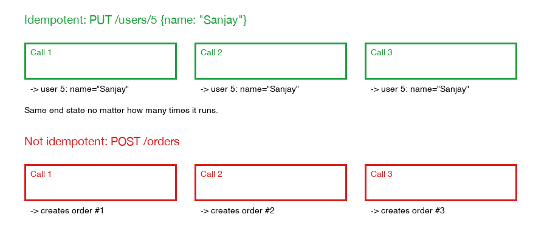
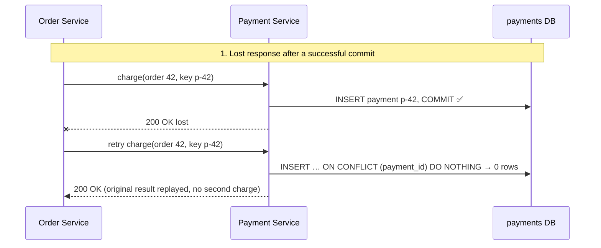

# Idempotency

> "Insanity is doing the same thing over and over again and expecting different results."
> — widely misattributed to Albert Einstein
>
> *Idempotency is the sane inverse: do the same thing over and over and expect exactly the same result.*

An operation is **idempotent** if doing it once and doing it many times (with the same input) leave the system in exactly the same end state — repeating it doesn't pile up extra side effects.



## Real-life analogy

Pressing an elevator call button. Press it once, the elevator is summoned. Pressing it five more times while you wait doesn't summon five elevators — it's already coming, so the extra presses do nothing extra. That's idempotent. Compare that to repeatedly hitting "submit" on a payment form where each click charges your card again — that's not idempotent, and it's exactly the kind of bug idempotency is meant to prevent.

Another version: flipping a light switch to the **ON** position five times leaves it ON — idempotent. *Toggling* a switch five times can leave it either ON or OFF depending on how many times you pressed it — not idempotent, because the result depends on how many times the action ran, not just that it ran.

## Where it shows up in real systems

- **HTTP methods**: `PUT` and `DELETE` are supposed to be idempotent by convention. `PUT /users/5 {name: "Sanjay"}` called once or five times leaves user 5 named "Sanjay" either way. `POST /orders` is classically not idempotent — calling it 3 times creates 3 orders. This is exactly why a network retry of a `POST` is dangerous: the client doesn't know if the first request actually succeeded before the connection dropped, so blindly retrying can double-charge or double-create.
- **Idempotency keys**: the standard fix for that `POST` problem — the client generates a unique key per logical operation (e.g. a UUID) and sends it in a header (`Idempotency-Key: ...`). The server remembers which keys it already processed and, if it sees the same key again, returns the original result instead of re-running the operation.
- **Message/event processing**: message brokers commonly guarantee only *at-least-once* delivery, so the same event can be delivered and processed twice. A handler like "release reserved stock" must not release stock twice for one event — otherwise inventory numbers drift upward every time a duplicate delivery happens. See [saga-pattern-compensating-transactions.md](saga-pattern-compensating-transactions.md) for why compensating actions specifically need this property.

## How to make an operation idempotent

- Prefer "set to X" over "change by X" — `status = CANCELLED` run twice gives the same result both times; `stock -= 1` run twice for the same logical event double-decrements. `SET` is naturally idempotent; `INCR`/`DECR` are not.
- Track a unique ID for each logical operation (an idempotency key, a message ID) and skip processing if that ID was already handled.
- Guard mutations with a state check — "only cancel if not already cancelled" — instead of unconditionally applying the change every time the handler runs.

## The concrete mechanisms

1. **Idempotency keys with a dedup store**: the client generates a unique key per logical attempt and sends it with the request. The server keeps a table of `(idempotency_key → result)`. On each request: look up the key first — if found, return the stored result without re-running any side effects; if not found, run the operation, store its result under that key, then return it. The lookup-then-execute-then-store sequence has to be atomic (usually enforced with a unique DB constraint on the key column), otherwise two near-simultaneous duplicate requests can both slip through the check before either has stored its result.
2. **Design the operation as "set to X," not "change by X"**: compute the target end state and write that directly, rather than expressing the operation as a delta. `UPDATE orders SET status = 'CANCELLED'` is naturally idempotent; `UPDATE inventory SET stock = stock - 1` is not — replaying it corrupts the count.
3. **Unique constraints for dedup at the database level**: a table can have a unique constraint on the natural key of the operation (e.g. `order_id`, or the idempotency key itself). A duplicate insert then fails with a constraint violation, which the app catches and treats as "already done" — returning the existing row instead of creating a second one.
4. **Conditional writes (guard the mutation with a state check)**: `UPDATE orders SET status = 'CANCELLED' WHERE status = 'PENDING'` — if the row is already `CANCELLED`, this affects zero rows. Running the same statement any number of times is a safe no-op, instead of a blind overwrite that might also fire unwanted side effects (like a second refund) every time.
5. **Consumer-side message dedup (the "inbox" pattern)**: for at-least-once message delivery, the consumer keeps a table of message IDs it has already processed. On receiving a message, it checks that table first; if the ID's already there, it skips processing entirely. This is the mirror image of the outbox pattern on the producer side.

**Real-life analogy**: a hotel check-in desk gives you a wristband stamped with a unique code the first time you check in. If you wander back to the desk later and show the same wristband, staff look up the code, see "already checked in," and just wave you through — they don't create a second reservation or charge your card again. The wristband code is the idempotency key; the "have I seen this code before?" lookup is the dedup mechanism.

## Client-generated vs server-issued keys — and a common bug

Idempotency keys are usually generated by the *client* (a random UUID, no round trip needed) — that's what Stripe and most payment APIs do. A valid alternative is *server-issued* keys: the client first asks the server for a key (e.g. when the "add order" page loads), the server generates and stores it, then the client attaches that key to the actual order request. This costs an extra round trip, but lets the server refuse any key it never issued, and lets the key carry server-side context (a reserved slot, a session).

Either way, the server-side check needs **three outcomes, not two** ("exists → process, else discard" is one bug short of correct):

1. **Key exists, unused** → process the request, then atomically mark the key "consumed" and store the resulting response (e.g. the new order ID) against it.
2. **Key exists, already consumed** → don't reprocess — return the *same stored response* from the first time.
3. **Key doesn't exist / expired** → reject.

The bug in "if exists → process, else discard": imagine the order succeeds, but the response is lost on the way back (dropped connection). The client, not knowing it succeeded, resubmits the same request with the same key. If the key still just "exists" with no consumed/unused distinction, the server processes it again — a second order. If instead the fix is to delete the key right after use, the retry now finds "key doesn't exist" and gets discarded — the client thinks the order *failed* and may create a brand-new key and a genuinely duplicate order, the opposite of the goal. Storing the result against the consumed key and replaying it on retries is what actually closes the loop.

The "check, then flip to consumed, then store result" sequence also needs to be atomic against two near-simultaneous duplicate requests (e.g. a double-click) — typically a conditional update like `UPDATE keys SET status = 'CONSUMED' WHERE key = ? AND status = 'UNUSED'`, so only one of two racing requests actually wins and processes the order.

## Why distributed systems settle for at-least-once

Every hop between services has to choose what happens when it's unsure whether a message got through:

- **At-most-once**: send once and never retry. Nothing is ever duplicated, but anything lost stays lost. That's acceptable for metrics, not for payments.
- **At-least-once**: retry until acknowledged. Nothing is lost, but anything whose *acknowledgement* was lost gets sent again.

For business data, losing a message is worse than seeing it twice, so Kafka consumers, outbox publishers, HTTP clients with retries and saga orchestrators all default to at-least-once. **Duplicates are therefore part of normal operation, and idempotency is how the receiver absorbs them.**

Three ways the same operation arrives twice:



1. **Lost response after a successful commit** (above). The work is done, but the caller can't know, so it retries.
2. **Duplicate message.** A Kafka consumer processes `PaymentCompleted` event `e-77` and commits its DB transaction, then crashes before committing the Kafka offset. On restart Kafka delivers `e-77` again. It's the same message, with the same event ID.
3. **Duplicate business operation.** The *same intent* arrives as *two different messages*: the user double-clicks "Pay", a buggy producer re-emits `OrderPlaced` with a fresh event ID, or an outbox row is re-published after a manual re-drive. The event IDs differ, but it's the same order.

## Message-level vs business-level idempotency

| | Message-level | Business-level |
|---|---|---|
| Question it answers | "Have I processed **this message** before?" | "Has **this business effect** already happened?" |
| Key | Event ID / message ID (`e-77`) | Natural business key: order ID, payment ID, `(order_id, attempt)` |
| Mechanism | Inbox table keyed by event ID | Unique constraint on the business table; conditional state transitions |
| Catches | Redelivery of the same message (case 2) | Different messages meaning the same thing (case 3), and case 2 as well |

**Why the event ID alone isn't enough.** Suppose Payment Service dedups only on event ID. A buggy producer emits `OrderPlaced` for order 42 twice, as `e-77` and `e-91`. Both IDs are new, both pass the inbox check, and the customer is charged twice. The fix is to make the *business* operation unique: `payments` has `UNIQUE (order_id)`, or `UNIQUE (order_id, attempt_no)` if retried payments after a decline are legitimate. The second charge then fails at the database whatever its event ID. The inbox stays useful as a cheap first filter and for operations with no natural key, but **the business constraint is the real guarantee**.

The identifiers in the checkout example and what each protects:

| ID | Generated by | Uniquely identifies | Use it to dedup |
|---|---|---|---|
| **Event ID** | The producer (outbox row ID) | One message | Redelivery of that message (inbox) |
| **Order ID** | Order Service | One order | "One active saga per order", "one shipment per order" |
| **Payment ID** | Order Service / orchestrator, *before* calling Payment | One payment attempt | Charges and refunds. Pass it to the gateway as its idempotency key |
| **Idempotency key** | The client, per logical request | One user intent | HTTP retries and double-clicks at the API edge |

Generating the payment ID *before* the call matters. If Payment Service generated it, a retry after a lost response couldn't refer to the payment it may already have created.

## The check-then-insert race

The intuitive implementation is a race:

```sql
-- Transaction A and B, concurrently, both for order 42
SELECT 1 FROM payments WHERE order_id = 42;   -- A: not found      B: not found
INSERT INTO payments (order_id, …) VALUES (42, …);   -- A: inserts   B: inserts → two payments
```

Under the default `READ COMMITTED` isolation, neither transaction can see the other's uncommitted insert, so both checks pass. Adding application-level locking around it just moves the problem. The fix is to let **one atomic statement backed by a unique constraint** decide:

```sql
ALTER TABLE payments ADD CONSTRAINT uq_payments_order UNIQUE (order_id);

INSERT INTO payments (payment_id, order_id, amount, status)
VALUES ('p-42', 42, 999, 'PENDING')
ON CONFLICT (order_id) DO NOTHING
RETURNING payment_id;     -- a row back → we own it, proceed;  no row → already exists, load and return it
```

When A and B race, PostgreSQL makes B's insert **wait** on A's uncommitted conflicting row. If A commits, B's insert becomes a no-op. If A rolls back, B's insert proceeds. Exactly one wins, with no gap between the check and the write. Prefer `ON CONFLICT DO NOTHING` over catching a unique-violation exception: in PostgreSQL an error aborts the whole surrounding transaction, unless it's wrapped in a savepoint.

## Idempotency, retries and compensation

- **Retries are only safe if the retried operation is idempotent.** Retry with the *same* key every time. A retry that generates a new key is a new operation.
- **Compensations are retried too**, so they need their own idempotency: one refund per `payment_id`, and release only `WHERE status = 'RESERVED'`. See [saga-pattern-compensating-transactions](saga-pattern-compensating-transactions.md#idempotency-matters).
- **Forward and compensating actions must agree on identity.** The refund references the original `payment_id` so a duplicate refund can be recognised, and so a refund can't be issued for a payment that never happened.

## Why exactly-once across independent systems is so hard

To process a message exactly once, a consumer would need to **apply the effect** and **acknowledge the message** as one atomic step. These are writes to two systems: its database and the broker's offset log. Without a transaction spanning both (2PC, which Kafka doesn't offer with external databases), there's always a gap. Ack first and crash, and the effect is lost. Apply first and crash, and the message is redelivered. The same holds for any HTTP call whose response can be lost.

What *is* achievable is narrower:

- **Exactly-once within one system.** Kafka transactions make "consume from topic A, produce to topic B, commit offset" atomic, *as long as everything stays inside Kafka*.
- **Effectively-once across systems.** At-least-once delivery plus idempotent receivers (inbox and business constraints) means the message may arrive several times, but the *effect* happens once.

See [distributed-transactions](distributed-transactions.md) for how this fits with sagas, the outbox and leases.

## See also

- [distributed-transactions](distributed-transactions.md) — the hub note on cross-service consistency, and why leases and fencing still leave idempotent receivers as the last line of defence.

- [write-ahead-log](write-ahead-log.md) — crash recovery replays a log that may already be partly applied, so replay has to be idempotent; databases get that from a per-page log sequence number.
- [zookeeper-distributed-coordination](zookeeper-distributed-coordination.md) — fencing tokens are the same concern: a paused lock holder must not be able to apply a stale write when it wakes up.
- [http-headers](http-headers.md) — `Idempotency-Key` and the conditional headers (`If-Match`) that give you optimistic concurrency over HTTP.
- [outbox-and-inbox-patterns](outbox-and-inbox-patterns.md) — the inbox pattern in full, and the producer-side outbox that makes duplicates an expected part of normal operation rather than a defect.
