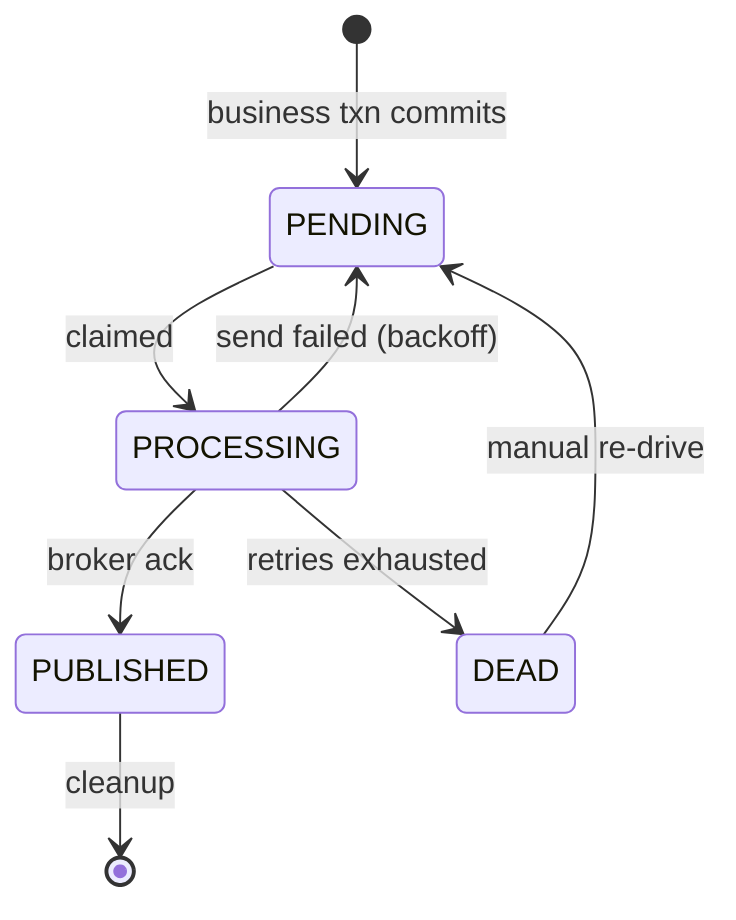

# The Outbox and Inbox Patterns

> "Two systems, one truth, no transaction between them."
>
> *The outbox makes sure the message is never lost; the inbox makes sure it is never applied twice. You need both, because neither is sufficient alone.*

## The problem: the dual write

Almost every service eventually has to do two things at once:

```
1. Change its own database   (save the order)
2. Tell the outside world    (publish OrderPlaced)
```

These live in **two different systems** — your database and your broker — and there is no transaction spanning them. So whatever order you choose, a crash in the gap breaks something:

| Order | Crash in the gap | Result |
| --- | --- | --- |
| **Publish, then commit** | DB transaction rolls back after the message went out | **Phantom event** — the world believes in an order that doesn't exist. Inventory reserved, email sent, nothing to ship |
| **Commit, then publish** | Process dies before publishing | **Lost event** — the order exists but nothing downstream ever hears. Silent, and usually discovered by a customer |

Both failure modes are *rare* and *silent*, which is the worst combination: they don't show up in testing, and when they do happen in production the data is already inconsistent.

**"But I publish inside `@Transactional` — isn't that atomic?"** No. `@Transactional` binds one database connection. `kafkaTemplate.send()` inside the method talks to a different system that isn't enrolled in that transaction, so the message is on its way, and possibly already consumed, before the database decides whether to commit. If the method throws afterwards, the DB rolls back and the event is a phantom. Kafka's own transactions don't change this: they make several Kafka writes and consumer-offset commits atomic *with each other*, not with PostgreSQL. Chaining a Kafka transaction with a DB transaction (commit one, then the other) only narrows the gap, and a crash between the two commits still produces one of the two failures above.

**Why not just use a distributed transaction (2PC)?** It technically solves this, but it's blocking (a coordinator failure leaves locks held), it's slow, and most modern brokers — Kafka, SQS, RabbitMQ in typical setups — don't support XA with your database in a way anyone wants to operate. The whole industry moved away from it, which is why these two patterns exist.

**Real-life analogy.** A shop clerk must record a sale in the ledger and hand the order slip to the courier. If they give the slip to the courier first and then discover the card was declined (**publish then roll back**), a parcel goes out for a sale that never happened. If they record the sale and then drop dead before reaching the courier (**commit then crash**), the customer is charged and nothing ships. The fix is that the clerk never talks to the courier at all: they write the sale **and** a note in an out-tray, both in the same ledger, in one stroke of the pen (**one database transaction**). A separate runner empties the out-tray whenever they pass (**the relay**). The runner may occasionally deliver the same slip twice, so the courier keeps a list of slip numbers already accepted (**the inbox**) and bins repeats.

---

## The outbox pattern (producer side)

**Write the event into your own database, in the same transaction as the business change.** Publishing becomes someone else's problem, later.

```sql
BEGIN;
  INSERT INTO orders (id, customer_id, total) VALUES (...);
  INSERT INTO outbox (id, aggregate_id, type, payload, created_at)
       VALUES (..., 'OrderPlaced', '{...}', now());
COMMIT;
```

Both rows commit or neither does — because it's **one transaction in one database**. The dual write is gone; there is now only a single write.

A separate **relay** then reads unpublished rows and pushes them to the broker:

```
[ Service ] ──one txn──► [ orders table ]
                         [ outbox table ] ──► [ relay ] ──► [ broker ] ──► consumers
```

**"Relay" here means a forwarder** — the component that *carries* messages from the outbox to the broker without originating or consuming them. It's borrowed from the relay race: your service runs its leg and drops the baton in the out-tray; the relay picks it up and runs the next leg. (Same sense as a radio relay station or a mail relay — receive, then pass on unchanged.)

It's a **role, not a technology**. Concretely it can be:

- a `@Scheduled` method inside the same service (the usual starting point),
- a separate small deployment dedicated to draining the table, or
- an off-the-shelf CDC connector like Debezium.

The property that makes it work is that it runs **outside the original transaction, asynchronously**. The service commits and returns to the caller immediately; whether the message has reached the broker yet is not its concern. That decoupling is exactly what removes the dual write — and also exactly why delivery can only be at-least-once.

### Two ways to run the relay

| | **Polling publisher** | **CDC / log tailing** |
| --- | --- | --- |
| How | `SELECT * FROM outbox WHERE published_at IS NULL` on a timer | Read the database's replication log directly — Debezium on the Postgres WAL or MySQL binlog ([write-ahead-log](write-ahead-log.md)) |
| Latency | Polling interval (typically 100 ms–1 s) | Near-real-time |
| Load | Constant queries even when idle | None on the table |
| Ordering | Whatever your query orders by | Exactly the commit order |
| Complexity | Trivial — a scheduled job | A connector to deploy, configure and operate |
| Deletes | You mark and clean up rows | The log already has them |

**Start with polling.** It's a `@Scheduled` method, it's easy to reason about, and its latency is fine for most systems. Move to CDC when the polling load or the latency actually hurts.

### Why the outbox is only half the answer

The relay publishes a row, then marks it published. If it crashes **between** those two steps, the row is still unpublished — so on restart it publishes again.

That's unavoidable: marking-then-publishing loses messages instead, which is worse. So the outbox gives you **at-least-once delivery**, and duplicates are a normal, expected part of its operation — not a bug to fix on the producer side.

---

## The inbox pattern (consumer side)

Since duplicates are guaranteed, the consumer must make **re-processing harmless**. The inbox pattern does that by recording what it has already handled — in the same transaction as the work itself:

```sql
BEGIN;
  INSERT INTO inbox (message_id) VALUES ('msg-abc');   -- PK violation if seen before
  UPDATE inventory SET reserved = reserved + 1 WHERE sku = 'X';
COMMIT;
```

If the message arrives twice, the second `INSERT` violates the primary key, the transaction rolls back, and **the side effect doesn't happen twice.** The uniqueness constraint is doing the deduplication — no extra locking, no distributed coordination.

The atomicity is the whole point: recording the ID and doing the work must commit together. Record-then-work loses messages on a crash between them; work-then-record double-applies.

See [idempotency](idempotency.md) — the inbox is one concrete mechanism for it, and where the operation is *naturally* idempotent (setting a status to a fixed value, an upsert by key) you may not need an inbox table at all.

### The inbox table

```sql
CREATE TABLE inbox (
    event_id     UUID PRIMARY KEY,          -- the dedup key: the producer's outbox row ID
    event_type   VARCHAR(128) NOT NULL,
    source       VARCHAR(64)  NOT NULL,     -- producing service/topic, if IDs are only unique per source
    received_at  TIMESTAMPTZ  NOT NULL DEFAULT now(),
    processed_at TIMESTAMPTZ               -- only needed with the status-based variant below
);
```

Inside the transaction, use `INSERT … ON CONFLICT (event_id) DO NOTHING` and check the affected row count (1 = new, do the work; 0 = duplicate, skip). Don't let the insert fail with a unique-violation error. In PostgreSQL that aborts the whole transaction, and you'd need a savepoint to carry on.

### Failure matrix (Kafka consumer + PostgreSQL)

The consumer's order of operations is: **(1)** receive from Kafka → **(2)** `BEGIN` → **(3)** insert inbox row → **(4)** business change → **(5)** `COMMIT` → **(6)** commit Kafka offset.

| Crash / failure point | DB state afterwards | Kafka offset | What happens next | Outcome |
|---|---|---|---|---|
| After (1), before (5) — consumer dies mid-transaction | Rolled back: no inbox row, no business change | Not committed | Kafka redelivers to this or another instance; processed normally | ✅ Processed once |
| Business logic throws in (4) | Rolled back | Not committed | Redelivered; if it fails every time it's a **poison message** → after N attempts send to a dead-letter topic | ✅ No partial effect; needs a DLT for permanent failures |
| (5) `COMMIT` succeeds, then crash before (6) | Inbox row + business change committed | Not committed | Redelivered → inbox insert conflicts → skip work → commit offset | ✅ Processed once (this is *the* case the inbox exists for) |
| (6) offset commit fails (rebalance, broker error) | Committed | Not committed | Same as above | ✅ Processed once |
| Offset committed **before** (5) (auto-commit on, or manual commit too early) | Transaction then fails or crashes | Committed | Message never redelivered | ❌ **Lost.** Commit offsets only after the DB commit |
| Inbox row and business change in **separate** transactions | Inbox committed, business change lost (or vice versa) | — | Redelivery is skipped as "already seen" (or applied twice) | ❌ Reintroduces the dual write |

Turn Kafka auto-commit off for inbox consumers, or make sure the listener container commits offsets only after the listener method (and its DB transaction) returns successfully.

### Multiple consumer instances

Within one Kafka consumer group, each partition is assigned to one instance at a time, so normally two instances don't process the same message at once. Concurrent duplicates still happen:

- **During a rebalance**, a partition moves from instance A to instance B while A is still mid-transaction on a message it hasn't committed the offset for. B receives the same message.
- **Two different messages for the same business entity**, e.g. a duplicate event with a different ID (see [idempotency](idempotency.md#message-level-vs-business-level-idempotency)), land on different partitions.

The inbox handles the first case without any extra locking. Both instances try `INSERT INTO inbox (event_id) …` for the same ID, PostgreSQL makes the second **wait** on the first's uncommitted row, and then it either sees a conflict (first committed → skip) or succeeds (first rolled back → process). The unique index is the lock. The second case needs a business-level unique constraint.

### Insert-in-transaction vs a separate claim with statuses

The pattern above inserts the inbox row **in the same transaction as the business change**, with no status column. Some designs instead give the inbox a lifecycle: `RECEIVED → PROCESSING → PROCESSED / FAILED`.

| | Insert within the business transaction | Store first, then claim and process separately |
|---|---|---|
| Steps | One transaction: insert inbox row + business change | Txn 1: insert `RECEIVED` and ack Kafka. Txn 2: claim → `PROCESSING`. Work. Txn 3: mark `PROCESSED` |
| Atomicity of dedup + effect | ✅ Guaranteed by one commit | ❌ Lost. A crash between the work and "mark `PROCESSED`" leaves it unclear whether the work happened |
| Kafka coupling | Offset held until processing finishes | Kafka acked as soon as the row is stored. The inbox becomes your own durable queue, with its own retries and backoff, and is no longer blocked by one slow message |
| Work that can't be in a DB txn (external API call) | Doesn't fit | Fits, but the external call must itself be idempotent |
| Crash recovery | Nothing to recover, it just rolled back | Rows stuck in `PROCESSING` need a **lease** (`claimed_by`, `lease_until`) so another worker can reclaim them, and the reclaimed work may run twice |

**Recovery implications of a separate `PROCESSING` state.** Once "I'm working on it" is committed separately from the work's result, a crash leaves a row saying `PROCESSING` with no owner. That needs exactly the lease and fencing machinery described in [distributed-transactions](distributed-transactions.md#leases), and the work it guards will sometimes run twice. Use the status-based variant only when you need it (external side effects, long processing, decoupling from Kafka), and make the work idempotent at the business level when you do.

---

## Together: effectively-once without distributed transactions

```
OUTBOX  →  guarantees the event is never LOST          (at-least-once out)
INBOX   →  guarantees the event is never APPLIED TWICE (dedup on the way in)
─────────────────────────────────────────────────────────────────
         =  effectively-once processing
```

Note what that is **not**: exactly-once *delivery*, which is impossible across a network. The message may well cross the wire several times. What you get is **exactly one effect**, which is the property anyone actually wanted.

Each pattern is insufficient alone: outbox without inbox means duplicate charges and double-decremented inventory; inbox without outbox means deduplicating messages that sometimes never arrive.

---

## Implementation notes

### The outbox table

```sql
CREATE TABLE outbox (
    id            UUID PRIMARY KEY,
    aggregate_id  VARCHAR(64) NOT NULL,   -- becomes the partition key: per-aggregate ordering
    type          VARCHAR(128) NOT NULL,
    payload       JSONB NOT NULL,
    created_at    TIMESTAMPTZ NOT NULL DEFAULT now(),
    published_at  TIMESTAMPTZ              -- NULL = not yet published
);

CREATE INDEX ON outbox (created_at) WHERE published_at IS NULL;   -- partial: stays tiny
```

The partial index matters — it covers only the unpublished backlog, so the query stays fast no matter how many rows the table has accumulated.

### Outbox lifecycle: PENDING → PROCESSING → PUBLISHED / DEAD

The `published_at IS NULL` table above is the minimal version. Once several publisher instances, retries and poison events are involved, an explicit status column makes the lifecycle visible:



One transition the diagram leaves out: a `PROCESSING` row whose lease has expired, because its publisher crashed or stalled, is re-claimed by another publisher and stays `PROCESSING` under a new owner.

Typical extra metadata alongside `id`, `aggregate_type`, `aggregate_id`, `event_type`, `payload`, `created_at`:

| Column | Why |
|---|---|
| `status` | `PENDING` / `PROCESSING` / `PUBLISHED` / `DEAD` |
| `attempts`, `next_attempt_at` | Retry bookkeeping; the claim query only takes rows whose `next_attempt_at <= now()` |
| `last_error` | The most recent failure, for whoever investigates a `DEAD` row |
| `claimed_by`, `claimed_at`, `lease_until`, `claim_token` | Multi-instance claiming and crash recovery; see [distributed-transactions](distributed-transactions.md#atomic-claiming) |
| `published_at` | When the broker acknowledged; used for cleanup and lag metrics |
| `headers` / `trace_id` | Propagated into the Kafka record so a trace spans producer → consumer |

**Rules that make it correct:**

- **Publish outside the DB transaction, and mark `PUBLISHED` only after the broker ack.** Wait for the send result with `acks=all` for durability. Marking first, then publishing, loses events on a crash. Publishing first, then marking, duplicates them on a crash, which is the acceptable direction.
- **Retry with exponential backoff and jitter** (`next_attempt_at = now() + min(cap, base × 2^attempts) ± jitter`). A broker outage then doesn't turn every publisher into a tight retry loop.
- **Classify errors.** Broker unavailable or timeout is retryable. A payload too large for the topic, or one that fails serialization, will fail forever, so send it to `DEAD` immediately instead of burning retries.
- **Per-aggregate ordering vs retries.** If event 2 for order 42 is published while event 1 sits in backoff, consumers see them out of order. If order matters, make the claim query skip aggregates that have an earlier unpublished event, or publish an aggregate's events serially.

**Where duplicates come from**, so the consumer's inbox is never optional:

1. Crash after the broker ack, before the `PUBLISHED` update. The lease expires and the row is published again.
2. The broker wrote the record but the ack was lost (a timeout). The publisher retries.
3. A stale publisher, paused past its lease, sends after another instance already has. See [distributed-transactions](distributed-transactions.md#stale-publishers-and-fencing-tokens).
4. A manual re-drive of `DEAD` rows that had in fact been published.

Kafka's idempotent producer (`enable.idempotence=true`) removes duplicates caused by *one producer's internal retries* within a session. It doesn't help with 1, 3 or 4, which are separate sends. So the outbox gives **reliable at-least-once publication**, and exactly-once *effect* still depends on the consumer.

**Monitoring and dead events.** Alert on:

- oldest `PENDING` age (publisher lag — the most useful single metric),
- count of `PROCESSING` rows with an expired lease (crashed or stuck publishers),
- count of `DEAD` rows (any non-zero value needs a human),
- publish error rate.

`DEAD` rows are never deleted automatically. They are investigated, fixed (bad payload, missing topic, ACL), and re-driven to `PENDING`.

### Writing and relaying, in Spring

```kotlin
@Service
class OrderService(
    private val orders: OrderRepository,
    private val outbox: OutboxRepository,
) {
    /** The whole point: the order and its event commit together, or not at all. */
    @Transactional
    fun place(order: Order): Order {
        val saved = orders.save(order)
        outbox.save(OutboxMessage(aggregateId = saved.id, type = "OrderPlaced", payload = saved.toEvent()))
        return saved
    }
}

@Component
class OutboxRelay(private val outbox: OutboxRepository, private val broker: MessagePublisher) {

    @Scheduled(fixedDelay = 500)
    @Transactional
    fun publishPending() {
        // SKIP LOCKED lets several instances drain the table concurrently
        // without two of them grabbing the same row.
        outbox.findUnpublishedForUpdateSkipLocked(limit = 100).forEach { message ->
            broker.publish(topic = message.type, key = message.aggregateId, payload = message.payload)
            message.markPublished()   // dirty checking flushes at commit
        }
    }
}
```

`SKIP LOCKED` is the detail that makes a multi-instance relay safe. Without it, either you run exactly one relay instance (a single point of failure) or two instances publish the same row concurrently.

This relay is deliberately the simplest correct shape. It holds the database transaction, and the row locks, **open across the broker calls**, because the locks only last until commit. That's fine at low volume. Under load, or when the broker is slow, it ties up DB connections and lock time for the duration of network I/O. The production shape is a short **claim transaction** (set `PROCESSING` + lease, commit), then publish outside any transaction, then a conditional `PUBLISHED` update. See [distributed-transactions](distributed-transactions.md#chapter-7-concurrency-control-and-distributed-claiming) for the claim, lease and fencing details.

### Consuming with an inbox

```kotlin
@Component
class InventoryConsumer(private val inbox: InboxRepository, private val inventory: InventoryService) {

    @Transactional
    fun onOrderPlaced(messageId: String, event: OrderPlaced) {
        // Unique constraint on messageId does the deduplication for us.
        if (!inbox.recordIfNew(messageId)) return    // already processed — silently skip

        inventory.reserve(sku = event.sku, quantity = event.quantity)
    }
}
```

### Housekeeping

- **Clean up the outbox.** Delete or archive published rows on a schedule (say, older than 7 days). An unbounded outbox table is the most common operational complaint about this pattern.
- **Prune the inbox** too, but only beyond your broker's maximum retry/redelivery window — delete an ID too early and a late redelivery gets reprocessed.
- **Keep payloads small.** The outbox is not a document store; if the event is large, publish a reference and let consumers fetch.

### Ordering

Rows commit in transaction order, but a relay publishing in parallel can emit them out of order. If order matters — and it usually only matters *per entity* — use the `aggregate_id` as the broker partition key, so all events for one order land on one partition in order. Global ordering across all entities is far more expensive and almost never actually required.

---

## How to decide

### Do I need the outbox pattern here?

| Question to ask | → Yes, use an outbox | Real-life example | → No, publish directly | Real-life example |
|---|---|---|---|---|
| Does a lost event cause real damage? | Yes | An order placed but never sent to fulfilment | No, it's advisory | A "user viewed page" analytics ping |
| Does a phantom event cause real damage? | Yes | Inventory reserved for a rolled-back order | No | A cache-warming hint |
| Is the publish inside a DB transaction that can still roll back? | Yes | Anything in a `@Transactional` service method | No — the write already committed independently | A batch job publishing a summary afterwards |
| Can the consumer tolerate silent gaps? | No | Payments, inventory, ledgers | Yes | Metrics, logs, recommendations |

### Polling relay or CDC?

| Question to ask | → Polling | Real-life example | → CDC (Debezium) | Real-life example |
|---|---|---|---|---|
| How much end-to-end latency is acceptable? | Hundreds of ms is fine | An order confirmation email | Must be near-real-time | A trading or pricing feed |
| What's the event volume? | Moderate | A few hundred events/minute | Very high, or polling load is showing on the DB | Tens of thousands/second |
| Do you want to operate a connector? | No — a `@Scheduled` job is it | A small team | Yes, and you may already run one | An existing CDC pipeline feeding a warehouse |
| Is strict commit ordering required? | Approximate is fine | Per-aggregate ordering via partition key | Yes | Rebuilding a downstream replica |

### Do I need an inbox table?

| Question to ask | → Yes, inbox table | Real-life example | → No, natural idempotency is enough | Real-life example |
|---|---|---|---|---|
| Is the operation an increment or an append? | Yes — it accumulates | `reserved = reserved + 1`, appending a ledger entry | No | `status = SHIPPED` (setting a fixed value) |
| Does it have an external side effect? | Yes | Charging a card, sending an email | No | An internal upsert |
| Can you dedupe on a natural key instead? | No | A generic event stream | Yes — a unique constraint does it | `INSERT ... ON CONFLICT DO NOTHING` keyed by order ID |

---

## Common mistakes

| Mistake | Consequence |
| --- | --- |
| Publishing inside the transaction, before commit | Phantom events for transactions that roll back |
| Publishing after commit, in the same method | Lost events when the process dies in the gap |
| Outbox without a consumer-side inbox | Duplicates applied — double charges, double decrements |
| Recording the inbox ID in a *separate* transaction from the work | Reintroduces the exact dual-write problem you were fixing |
| Never cleaning up the outbox table | Unbounded growth; the relay query slows down over time |
| Pruning the inbox faster than the broker's redelivery window | A late redelivery is reprocessed as if new |
| Multi-instance relay without `SKIP LOCKED` (or a lock) | The same row published by several instances simultaneously |
| Expecting exactly-once *delivery* | Impossible across a network. Aim for exactly-once *effect* |
| Assuming global ordering | The relay parallelises; use the aggregate ID as partition key for per-entity order |
| Large payloads in the outbox | Table bloat and slow replication; publish a reference instead |
| Marking an outbox row `PUBLISHED` before the broker ack | A crash or failed send loses the event permanently |
| `PROCESSING` status without a lease | A crashed publisher's rows stay claimed forever |
| Committing the Kafka offset before the inbox transaction commits | A crash in between loses the message |
| Retrying non-retryable publish errors forever | A poison event blocks its aggregate and burns resources. Move it to `DEAD` |

## Key takeaways

1. **The problem is the dual write** — a DB change and a message publish with no transaction between them. Both orderings fail, silently.
2. **The outbox turns two writes into one** by putting the event in your own database, in the same transaction.
3. **A relay publishes it afterwards** — polling to start with, CDC when latency or load demands it.
4. **The outbox guarantees at-least-once, so duplicates are expected**, not a defect.
5. **The inbox makes duplicates harmless** by recording processed IDs in the same transaction as the work.
6. **Together they give exactly-once *effect*, not exactly-once delivery** — which is the property that was actually wanted.
7. **Neither works alone**: outbox without inbox double-applies; inbox without outbox deduplicates messages that may never arrive.
8. **Order per entity, not globally** — partition by aggregate ID.

## See also

- [distributed-transactions](distributed-transactions.md) — the hub note: why local transactions don't span services, 2PC, and `SELECT FOR UPDATE` / `SKIP LOCKED` / leases / fencing for multi-instance relays and inbox workers.
- [idempotency](idempotency.md) — the inbox is one mechanism for it; where an operation is naturally idempotent you may not need the table.
- [saga-pattern-compensating-transactions](saga-pattern-compensating-transactions.md) — how multi-service workflows stay correct once each step publishes its own events this way.
- [message-queue-vs-pubsub](message-queue-vs-pubsub.md) — what the relay is publishing into, and why at-least-once is the normal delivery guarantee.
- [write-ahead-log](write-ahead-log.md) — the log a CDC relay tails, and why "read the log" gives you replication and event publishing from the same mechanism.
- [async-transaction-confirmation](async-transaction-confirmation.md) — the user-facing side of committing now and completing the rest shortly afterwards.
