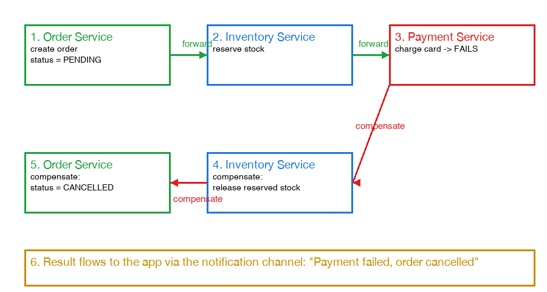
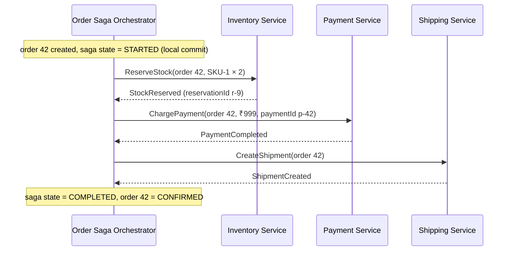
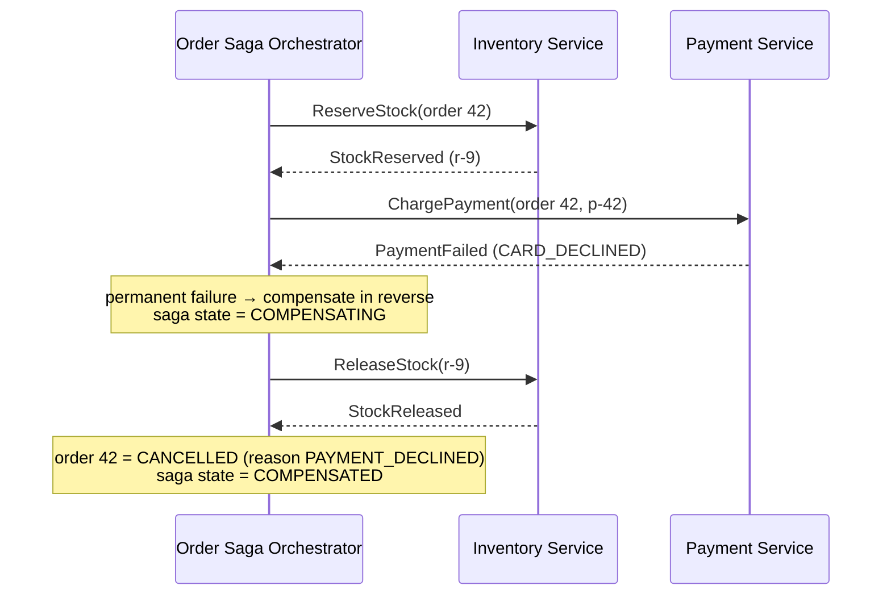
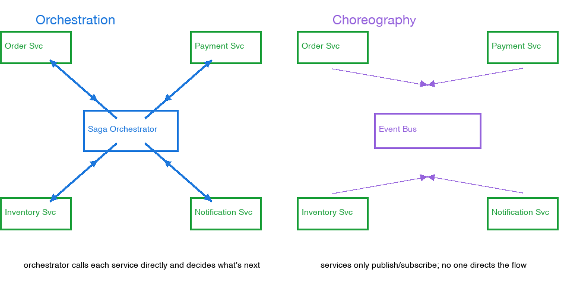

# Saga Pattern: Handling Failures Across a Multi-Step Distributed Transaction

> "To err is human; to forgive, divine."
> — Alexander Pope, *An Essay on Criticism*
>
> *A compensating transaction is a distributed system forgiving itself, one step at a time.*

## The core problem

In a single-database monolith, "create order + reserve inventory + charge payment" could be wrapped in one ACID transaction — if payment fails, the whole thing rolls back atomically, as if the order never existed.

In an event-driven/microservices system, each step belongs to a different service with its own database (see [monolith-vs-microservices.md](monolith-vs-microservices.md) for what "service" means here). The order service already committed its own local transaction and returned before payment even ran. There's no single transaction spanning all three services, so there's nothing to roll back — the order is a durable, committed fact in the order service's database by the time payment fails.

## The fix: compensating transactions

Instead of one atomic transaction, the flow is modeled as a chain of local transactions, and every step that can succeed gets a paired "undo" action — a compensating transaction — triggered if a later step fails.



1. Order Service creates the order, `status = PENDING` (local commit).
2. Inventory Service reserves stock for the order (local commit). Compensating action: release the reserved stock.
3. Payment Service charges the card — fails.
4. Compensations run in reverse order: Inventory Service releases the reserved stock, then Order Service moves the order to `CANCELLED` / `PAYMENT_FAILED` — not deleted, because analytics, order history, and the user's own app need to know it existed and why it ended. See [async-transaction-confirmation.md](async-transaction-confirmation.md) for how that final status actually reaches the client (polling, WebSocket/SSE push, or a push notification).

### Compensation is not rollback

A database rollback **erases**: the rolled-back rows were never visible to anyone else, so afterwards it is exactly as if nothing happened. A compensation is a **new, forward business action** that semantically cancels an earlier, already-committed one:

| Forward step | Rollback would mean | Compensation actually is |
|---|---|---|
| Charge ₹999 | The charge never existed | A **refund** of ₹999. Two ledger entries, possibly a fee, and it shows on the customer's statement |
| Reserve 2 units of SKU-1 | The reservation never existed | **Release** the reservation. Meanwhile another customer may have been told "only 1 left" |
| Create order 42 | No row | Order 42 moves to `CANCELLED` with a reason; history keeps it |
| Send "order confirmed" email | Impossible | A second "sorry, your order was cancelled" email. Some actions have **no** compensation at all |

The intermediate state was **visible** to other transactions and users while it existed (sagas have no isolation, see below), so a compensation has to cope with whatever happened in between.

## A complete example: success and failure paths

An orchestrated checkout with four participants. Each arrow is a command or reply over Kafka, and each participant commits its own local transaction.



**Failure path: the card is declined (a permanent business failure).**



Shipping never ran, so it needs no compensation. Compensations only run for steps that *completed*.

### Compensatable, pivot and retriable steps

It helps to classify each step by what can happen to it *after* it succeeds:

- **Compensatable** steps can be undone: create order (→ cancel), reserve stock (→ release).
- The **pivot** step is the go/no-go point. Once it succeeds, the saga is committed to finishing. Here that's **charge payment**.
- **Retriable** steps come after the pivot and are designed to always *eventually* succeed with enough retries, so they never need compensating. Here that's **create shipment**: if Shipping is down, you retry until it's up. You don't refund the customer because a warehouse API had an outage.

Ordering steps this way, with the cheap, easily undone ones before the pivot and the guaranteed-to-eventually-succeed ones after it, keeps the number of compensation paths small.

## Retry, compensate, wait or reconcile?

When a step doesn't return success, the orchestrator first has to work out **what kind of not-success it is**:

| Outcome of the step | Example | What it means | Action |
|---|---|---|---|
| **Permanent business failure** | `CARD_DECLINED`, `OUT_OF_STOCK` | The participant ran and said no. Retrying gives the same answer | **Compensate** earlier steps |
| **Transient technical failure** | 503, connection refused, broker unavailable | The participant didn't run, or failed before committing | **Retry** with exponential backoff + jitter, same idempotency key |
| **Ambiguous outcome** | Timeout, connection reset after the request was sent | Unknown. It may have succeeded | **Find out**: query status by idempotency key, or retry idempotently. Never compensate on a guess |
| **No reply for a long time** | Command sent, no event back after 10 min | Lost message, stuck consumer, or still running | Saga-level **timeout → reconciliation** |
| **Retries exhausted** | Payment provider down for an hour | Transient failure that hasn't cleared | Business decision: keep waiting, or treat as failure and compensate. Pick one *explicitly* per step |

### Why a timeout doesn't mean the operation failed

The orchestrator sends `ChargePayment` and its 5 s timeout fires. Possible realities:

1. The command never reached Payment Service. Nothing was charged.
2. Payment Service charged the card and committed, but the reply was lost or slow. **The card was charged.**
3. Payment Service is still waiting on the card network and will charge in 3 more seconds.

From the orchestrator's side all three look identical. If it treats the timeout as "payment failed" and cancels the order, cases 2 and 3 leave a **charged customer with a cancelled order**, the worst outcome in e-commerce. The right responses are:

- **Retry the same command with the same `paymentId`** as the idempotency key. If the charge already happened, Payment Service (and the gateway behind it) returns the original result instead of charging again.
- Or **ask**: `GET /payments/p-42`. Many payment gateways expose exactly this status lookup.
- If neither resolves it, move the saga to `PAYMENT_UNKNOWN` and let a **reconciliation job** compare against the gateway's settlement report later, instead of guessing now.

See [distributed-transactions](distributed-transactions.md#four-kinds-of-failure--and-why-the-fourth-is-the-hard-one) for the general failure taxonomy.

## When compensations fail

A compensation is just another remote call, so it can hit every failure above: the refund API is down, the release command times out, the message is delivered twice.

- **Compensations must be retryable.** Design them so retrying until success is always safe, which means idempotent (next section). Retry with backoff for as long as it takes. A compensation that gives up after three tries leaves the system permanently inconsistent.
- **Compensations should be designed to not fail for business reasons.** "Release reservation r-9" should succeed even if r-9 was already released or expired. A refund should be accepted even if the original charge was partially refunded. Validation that could reject a compensation belongs in the forward step.
- **Have an escalation path.** When a compensation keeps failing (e.g. the card was closed so the refund bounces), move the saga to `COMPENSATION_FAILED`, alert, and hand it to a manual-review queue or a finance reconciliation process. The saga state table (next section) is what makes these findable at all.

## Saga state persistence and crash recovery

An orchestrator is a state machine, and that state machine must live in a database, not in memory:

```sql
CREATE TABLE order_saga (
    saga_id        UUID PRIMARY KEY,
    order_id       BIGINT NOT NULL UNIQUE,
    state          VARCHAR(32) NOT NULL,   -- STARTED, STOCK_RESERVED, PAYMENT_PENDING, COMPLETED, COMPENSATING, COMPENSATED, COMPENSATION_FAILED …
    reservation_id VARCHAR(64),            -- data later compensations need
    payment_id     VARCHAR(64),
    updated_at     TIMESTAMPTZ NOT NULL,
    deadline_at    TIMESTAMPTZ             -- when to stop waiting for the current step
);
```

- **Each state transition and the next command commit together.** Moving to `PAYMENT_PENDING` and writing the `ChargePayment` command into the orchestrator's outbox happen in one local transaction ([outbox-and-inbox-patterns](outbox-and-inbox-patterns.md)). Otherwise the orchestrator can crash with the state advanced but the command never sent, or the reverse.
- **Recovery after a crash** is then just: on startup, or continuously, load sagas not in a terminal state and continue from their current state. A command may already have been sent before the crash and will be sent again, so participants must be idempotent.
- **Timeouts become queryable.** A scheduled job finds `WHERE state NOT IN (terminal states) AND deadline_at < now()` and decides per step: re-send, query status, or compensate. This job is a claimed work queue, so the [claiming and lease](distributed-transactions.md#chapter-7-concurrency-control-and-distributed-claiming) rules apply.

### The risk of events alone without durable workflow state

Pure choreography spreads the workflow across event handlers, and often nothing records *where each saga is*. That works until something goes quiet:

- `OrderPlaced` is published but Inventory's consumer has a bug and drops it. The order sits in `PENDING` **forever**, and no component's job is to notice.
- Payment emits `PaymentFailed`, Inventory handles it, and Order Service's handler crashes on a deserialisation error and sends the event to a DLQ. Stock is released but the order still says `PENDING`.
- An event is replayed out of order (`ReleaseStock` before `ReserveStock`), and with no saga state to check against, the release is a no-op and the late reserve then holds stock forever.

Choreographed systems that survive in production almost always add some durable state anyway: an order status with a timestamp, plus a **watchdog** that queries "orders in `PENDING` for more than 15 minutes" and reconciles them. That's a small orchestrator in disguise. Choose that knowingly.

## Sagas have no isolation

While the saga runs, other requests see its intermediate state: an order that's `PENDING`, stock that's reserved for a payment that may still fail. Common countermeasures:

- **Semantic lock.** A `PENDING`/`*_PENDING` status that other operations respect. For example, a "cancel order" request on a `PAYMENT_PENDING` order is rejected or queued until the saga settles.
- **Commutative updates.** Design updates so their order doesn't matter (`reserved += 2` / `reserved -= 2`), so concurrent sagas interleave safely.
- **Re-read before acting.** A later step re-checks the current value (is this order still active?) instead of trusting data captured when the saga started.

## Orchestration vs choreography

Both are ways to run a saga's steps and compensations. The difference is where the "brain" of the workflow lives.



### Orchestration — one coordinator directs everyone

A dedicated component (the "saga orchestrator") owns the entire sequence explicitly. It calls Order Service, waits for the result, then calls Inventory Service, waits, then calls Payment Service. If Payment fails, the orchestrator itself decides "now call Inventory's release-stock and Order's cancel, in that order" — the whole state machine (what step comes next, what to do on failure) lives in one place, as explicit code or a workflow definition.

- **Pros**: the entire flow is visible in one place — look at the orchestrator to answer "what state is order #123 in, and what happens next?" Easier to add retries, timeouts, or branching logic without touching the participant services. Easier to debug — one component to trace.
- **Cons**: that component now has to know about every step in the workflow (workflow-level coupling, even if the services themselves stay decoupled). It needs its own persistence so an in-flight saga survives a crash/restart.
- **Real tools**: AWS Step Functions, Temporal, Camunda — or a hand-rolled `OrderSagaOrchestrator` service.
- **Analogy**: a wedding planner. They call the caterer, then the venue, then the florist — directly, one by one — and if the florist cancels, the planner is the one who calls the caterer to adjust the headcount. One person holds the entire plan in their head.

The shape of the code — one place explicitly drives every step and its compensation:

```
function placeOrderSaga(order):
    orderService.create(order)
    try:
        inventoryService.reserve(order)
        try:
            paymentService.charge(order)
        except PaymentFailed:
            inventoryService.release(order)   // compensate step 2
            orderService.cancel(order)        // compensate step 1
    except InventoryUnavailable:
        orderService.cancel(order)            // compensate step 1
```

### Choreography — no coordinator, everyone reacts to events

There's no central component. Each service publishes events about what happened to it and subscribes to events it cares about, reacting on its own. Payment Service doesn't call anyone — it just publishes `PaymentFailed`. Inventory Service, independently listening for that event, releases stock because it knows that's its job when it hears that signal. Order Service, also listening, independently marks the order cancelled. The overall workflow isn't written down anywhere — it emerges from everyone's local reactions.

- **Pros**: services are fully decoupled — Payment Service doesn't even know Inventory Service exists. No single point of failure for the control flow. Adding a new participant (e.g. a fraud-check service) just means subscribing to an existing event — no other service needs to change.
- **Cons**: the overall flow is invisible — it's implicit, scattered across every service's event handlers. Debugging "why was this order cancelled?" means tracing a chain of events across several services' logs instead of reading one place. Risk of tangled or even cyclic event chains as the number of steps grows.
- **Analogy**: a relay race, or a bucket brigade fighting a fire. Nobody stands at the side directing the whole race — each runner just waits for the baton and knows their own leg of it. The overall result emerges from everyone doing their local job in response to what just happened next to them, with no one holding the full picture.

The shape of the code — each service only knows its own reaction, with no single place that sees the whole flow:

```
// Inside Payment Service
on OrderPlaced(order):
    result = chargeCard(order)
    if result.failed:
        publish PaymentFailed(order)
    else:
        publish PaymentSucceeded(order)

// Inside Inventory Service — has no idea Payment Service exists
on PaymentFailed(order):
    releaseReservedStock(order)

// Inside Order Service — also has no idea Inventory Service exists
on PaymentFailed(order):
    order.status = CANCELLED
```

### How to decide

| Question | Lean Choreography | Lean Orchestration |
|---|---|---|
| Number of steps in the saga | Few (2-3) | Many (4+) |
| Failure/retry/branching complexity | One simple failure path | Multiple failure paths, need retries/timeouts/conditional branching |
| Need centralized visibility into saga state? | No — no one needs to ask "what state is order #123 in?" from one place | Yes — ops/support need a single place to inspect progress |
| How often do participants change? | Frequently — new participants just subscribe to existing events, no one else changes | Rarely — the workflow is fairly fixed |
| Tooling/infra already in place | Just a pub/sub broker | A workflow engine (Temporal, AWS Step Functions, Camunda) already adopted or worth adopting |
| Team structure | Each service team wants full autonomy, no shared coordinator to maintain together | One team (or a platform team) is already responsible for the end-to-end business process anyway |

Choreography works well for a small number of steps with simple reactions — it stays decoupled without adding a moving part to maintain. As the number of steps or the amount of error/retry/branching logic grows, the implicit workflow gets hard to reason about, and orchestration usually wins because it makes the workflow explicit and inspectable — most teams switch once a saga passes 3-4 steps or has more than one failure path to handle.

A common hybrid: orchestrate the core business transaction (order → inventory → payment, where compensations must fire in a specific order) while letting side effects that don't participate in compensation — analytics logging, sending a marketing email — stay choreographed, just reacting to the same events independently.

**Analogy**: a small garage renovation with three contractors can get away with each one just watching for the previous one to finish and starting their own part — everyone can keep the whole plan in their head (choreography). A large multi-trade building project — electrical, plumbing, structural, inspections, with delays and rescheduling — needs a general contractor explicitly coordinating everyone, because the coordination logic itself has become too complex for anyone to track by just reacting to what they see next to them (orchestration).

## Real-life analogy

Booking a flight and a hotel as a package. You book the flight (reserved), then the hotel booking fails because the card gets declined. You can't roll back the flight booking as a database operation — the airline is a completely separate company with its own separate system. You have to explicitly call and cancel the flight. That cancellation is the compensating transaction — it leaves a trace (a cancelled-booking record, a refund entry) rather than making it look like you never booked at all.

## Idempotency matters

Message brokers typically guarantee at-least-once delivery, so a compensating action like "release stock" or "cancel order" might get triggered more than once for the same event. Running it twice must be a safe no-op — not a double-refund, not a crash, not a double-decrement of inventory back into stock. See [idempotency.md](idempotency.md) for what idempotency means more generally and how to design for it.

What idempotent compensation looks like in practice:

- **Key the compensation to the forward action's identity**, not to the message. "Refund `paymentId` p-42" can be checked against a `refunds` table with a unique constraint on `payment_id`, so a second refund for the same payment is rejected however many events ask for it. "Release reservation r-9" is a conditional update: `UPDATE reservations SET status = 'RELEASED' WHERE id = 'r-9' AND status = 'RESERVED'`. Zero rows updated means it was already done, so report success.
- **Treat "nothing to undo" as success.** If the release arrives for a reservation that was never made (the reserve command was lost), the compensation still succeeds. Otherwise the saga gets stuck retrying an undo that can never apply.
- **Handle the compensation overtaking the forward action.** With retries and redelivery, `ReleaseStock(order 42)` can arrive *before* a delayed `ReserveStock(order 42)`. Record a tombstone ("order 42 cancelled") when the release finds nothing. The late reserve then checks it and refuses, instead of holding stock for a dead order forever.

## See also

- [distributed-transactions](distributed-transactions.md) — the hub note: why local transactions don't span services, 2PC and why sagas replace it, and the claiming/lease rules that saga timeout scanners rely on.

- [database-sharding-partitioning-replication](database-sharding-partitioning-replication.md) — sagas are also the answer *inside* one application once a database is sharded, because a transaction can no longer span two shards.
- [outbox-and-inbox-patterns](outbox-and-inbox-patterns.md) — how each saga step publishes its event without a dual write, so a step can't commit locally and fail to notify the next one.
